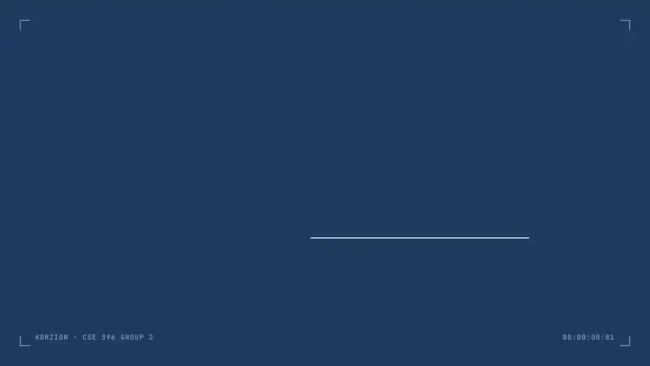
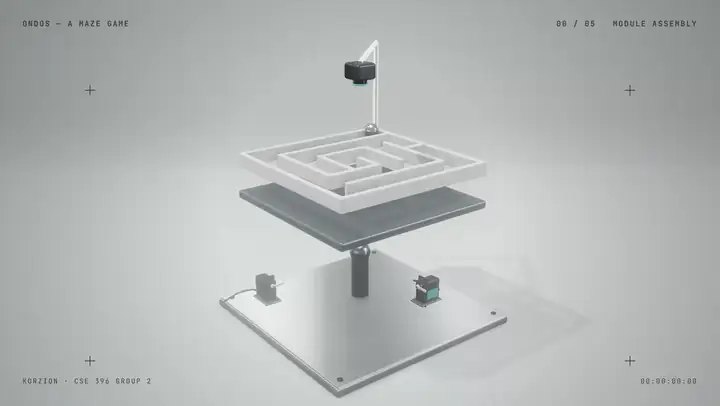

<div align="center">

# ONDOS

### A physical maze, a digital twin, and an intelligent way through.

Glove-controlled motion · Camera-based tracking · Real-time simulation · AI path planning


</div>

## Product concept films

Ondos is being explored through multiple visual directions. The films below are two evolving interpretations of the same product concept—not final marketing material. Their visual language, interaction details, and hardware representation may change as the prototype develops.

### Concept 01 — Blueprint

A technical, interface-led interpretation focused on the relationship between the glove, vision system, maze platform, and AI solver.

[](docs/media/ondos-concept-01-blueprint.mp4)

[Watch with sound (MP4)](docs/media/ondos-concept-01-blueprint.mp4)

### Concept 02 — Product Film

A cinematic, hardware-led interpretation that presents Ondos as a complete physical product and follows the system from assembly to autonomous maze solving.

[](docs/media/ondos-concept-02-product-film.mp4)

[Watch with sound (MP4)](docs/media/ondos-concept-02-product-film.mp4)

> [!NOTE]
> Both films are living concept studies. They represent different creative directions and remain open to revision as the mechanical design, interaction model, and software architecture evolve.

## The experience

| Stage | What happens |
| --- | --- |
| **Control** | The player tilts the physical maze with a sensor-equipped glove. |
| **Perception** | An overhead camera tracks the ball and maps the maze state. |
| **Simulation** | A digital twin mirrors the platform and movement in real time. |
| **Intelligence** | The AI module plans and demonstrates a path through the maze. |

## System

| Module | Folder | Role |
| --- | --- | --- |
| A Tilting Platform | [`tilting-platform/`](tilting-platform/) | Two-axis tilting maze, servos, IMU, safety; platform bridge to the bus |
| B Glove Controller | [`glove-controller/`](glove-controller/) | Hand tilt over ESP-NOW and haptic warnings |
| C Vision | [`vision/`](vision/) | Ball tracking, maze reading, hand detection and route planning |
| D Auto Controller | [`auto-controller/`](auto-controller/) | AI and PID controllers; offline Learning (AI parts in `auto-controller/ai/`) |
| E Control Station | [`control-station/`](control-station/) | GameManager, operator app with plots, camera and 3D Twin, Recorder |
| Shared | [`shared/`](shared/) | Interfaces (topic names, schemas), bus helpers, mazes, replay tool, test base |

The design is described in the *Ondos Module Design* document (CSE396 Group 2).

## Getting started (developers)

```
pip install -e .                              # Python 3.11: shared library (bus, interfaces, replay, tests)
npm install                                   # TypeScript parts of shared/
mosquitto -c shared/bus/mosquitto.conf        # local broker for standalone work
python <module>/run_test.py --list            # tests of a module
```

Topic names, message fields and packet layouts come only from [`shared/interfaces/`](shared/interfaces/).

## Project status

Ondos is an evolving prototype developed by **Korzion** for **CSE 396 at Gebze Technical University**. The repository documents the work in progress across hardware, embedded systems, computer vision, simulation, and AI.

See [CONTRIBUTING.md](CONTRIBUTING.md) for the team workflow and contribution rules.
