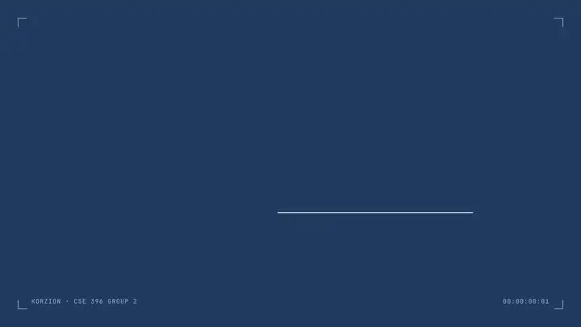
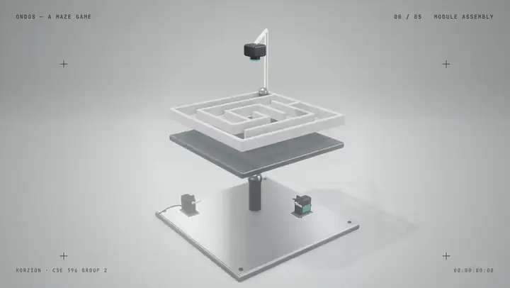

# ONDOS

### A physical maze, a digital twin, and an intelligent way through.

Glove-controlled motion · Camera-based tracking · Real-time simulation · AI path planning

## Product concept films

Ondos is being explored through multiple visual directions. The films below are two evolving interpretations of the same product concept—not final marketing material. Their visual language, interaction details, and hardware representation may change as the prototype develops.

### Concept 01 — Blueprint

A technical, interface-led interpretation focused on the relationship between the glove, vision system, maze platform, and AI solver.

[Watch with sound (MP4)](docs/media/ondos-concept-01-blueprint.mp4)

### Concept 02 — Product Film

A cinematic, hardware-led interpretation that presents Ondos as a complete physical product and follows the system from assembly to autonomous maze solving.

[Watch with sound (MP4)](docs/media/ondos-concept-02-product-film.mp4)

> [!NOTE]
> Both films are living concept studies. They represent different creative directions and remain open to revision as the mechanical design, interaction model, and software architecture evolve.

## The experience

| Stage | What happens |
| --- | --- |
| **Control** | The player tilts the physical maze with a sensor-equipped glove. |
| **Perception** | An overhead camera tracks the ball and maps the maze state. |
| **Simulation** | A digital twin mirrors the platform and movement in real time. |
| **Intelligence** | The AI module plans and demonstrates a path through the maze. |

## System

| Module | Role |
| --- | --- |
| [`platform/`](platform/) | Tilting maze platform, mechanics, and motion control |
| [`glove/`](glove/) | Wearable sensing and haptic interaction |
| [`vision/`](vision/) | Camera-based ball and maze tracking |
| [`simulator/`](simulator/) | 3D simulation and digital twin |
| [`path-planning/`](path-planning/) | Maze representation and route planning |
| [`ai/`](ai/) | Intelligent control and decision-making |
| [`control-station/`](control-station/) | System orchestration and operator interface |

## Project status

Ondos is an evolving prototype developed by **Korzion** for **CSE 396 at Gebze Technical University**. The repository documents the work in progress across hardware, embedded systems, computer vision, simulation, and AI.

See [CONTRIBUTING.md](CONTRIBUTING.md) for the team workflow and contribution rules.
