# Ondos – A Maze Game

Korzion (Group 2)

CSE 396 Computer Engineering Project – Gebze Technical University

November 9, 2026

**Project team**

- Ahmet Arif Aygün
- Beyzanur Bilir
- Enis Talha Şahin
- Süleyman Mevlid Uzun
- Mohammed Z A Alaklouk
- Talha Tanrıverdi
- Mert Sezer Güler
- İbrahim Ahmetoğlu
- Yağmur Gül
- Aayan Mustafa

**Modules and members**

| Module | Members |
| --- | --- |
| A Tilting Platform | Beyzanur Bilir, Enis Talha Şahin, Mohammed Z A Alaklouk, Aayan Mustafa |
| B Glove Controller | Aayan Mustafa, Ahmet Arif Aygün, Mert Sezer Güler |
| C Vision | Talha Tanrıverdi, Mert Sezer Güler, İbrahim Ahmetoğlu, Yağmur Gül |
| D Auto Controller | İbrahim Ahmetoğlu, Süleyman Mevlid Uzun, Talha Tanrıverdi, Enis Talha Şahin, Yağmur Gül |
| E Control Station | Mohammed Z A Alaklouk, Ahmet Arif Aygün, Beyzanur Bilir, Süleyman Mevlid Uzun, Yağmur Gül |

## Part I – System

### 1. Introduction

Ondos is a ball-maze game on a platform that tilts in two directions. A player wears a glove with a motion sensor and tilts their hand; the platform follows the hand. A camera above the maze reads the walls, the start and the exit, follows the ball and plans the route to the exit. The Control Station manages the game, shows it as a 3D view and live plots, lets the operator start, pause and stop the game, trigger an emergency stop and change control variables while the system runs, and records every game.

Besides the glove, the platform can be driven by two automatic controllers: an AI Controller and a PID Controller. The AI learns how to tilt the platform to move the ball along the route, first in a training environment and then also from recorded player games. It is compared with the players and with the PID Controller. The maze can be changed during a game: the system pauses, reads the new maze, plans a new route and continues.

This document defines the architecture, interfaces and tests of five modules. Each module can be demonstrated on its own. Numeric values are targets that guide the tests in each module chapter; they are refined by measurement (see About the numbers).

**How to read it:** Part I describes the system as a whole – modules, flows, game states and an overview of the interfaces. Part II has one chapter per module with the same headings; section X.6 lists the module's inputs and outputs. The Appendix gives the full interface specification (field tables, rates, timeouts and error behaviour) for readers who need the details.

**About the numbers:** field names, types, units, topic names and the safety timeouts (command timeout 200 ms; HostState and gate 300 ms; GloveData loss 300 ms; GameInfo loss 1 s; controller input freshness 100 ms) are fixed interface rules. Other numbers – thresholds, gains, delay budgets and the targets in the test tables – are starting values from estimates. They are refined by measurement during the project; the tunable ones are changed through variables_spec without a new document version.

### 2. System architecture

The system has two microcontrollers and one computer: the platform ESP32 drives the motors, the glove ESP32 reads the hand, and one station laptop runs everything else. Glove mode works with the glove and the platform alone (after one short press of the mode button); with the laptop the system adds tracking, route planning, the automatic controllers, the screens and recording.

#### 2.1 Modules

| Module | What it does | Inputs | Outputs |
| --- | --- | --- | --- |
| A Tilting Platform | Tilts the maze on two axes with servos, measures the plate angle, enforces limits, the command timeout and the E-stop; its bridge connects the ESP32 to the laptop | Glove packets, target tilts, game state, commands | Measured tilt, platform and glove state, safety state |
| B Glove Controller | Measures the hand tilt and plays vibration warnings | Hand motion, haptic commands | Hand tilt and glove status |
| C Vision | Tracks the ball, reads the maze, detects a hand in the playfield and plans the route to the exit | Camera frames, scan and calibration commands | Ball state, maze, distance map, route, edit state |
| D Auto Controller | AI Controller and PID Controller compute target tilts; Learning trains the AI offline | Ball state, route, platform state, game state, saved model, recordings | AI or PID target tilts, controller status, model files |
| E Control Station | GameManager runs the game (states, mode, finish, warnings); the app shows plots, camera, 3D Twin and control variables; the Recorder keeps the games (the shared replay tool plays them back) | Telemetry from A, C and D, operator commands, recordings | Game state, warnings, commands, settings, recording files |

The replay tool (shared/tools/replay) and sample recordings (shared/samples/) are shared infrastructure in the repository, not a module. Any module can call the replay tool, for example to feed its own tests with a recorded game; the Control Station uses it to show recorded games.

#### 2.2 Logical view

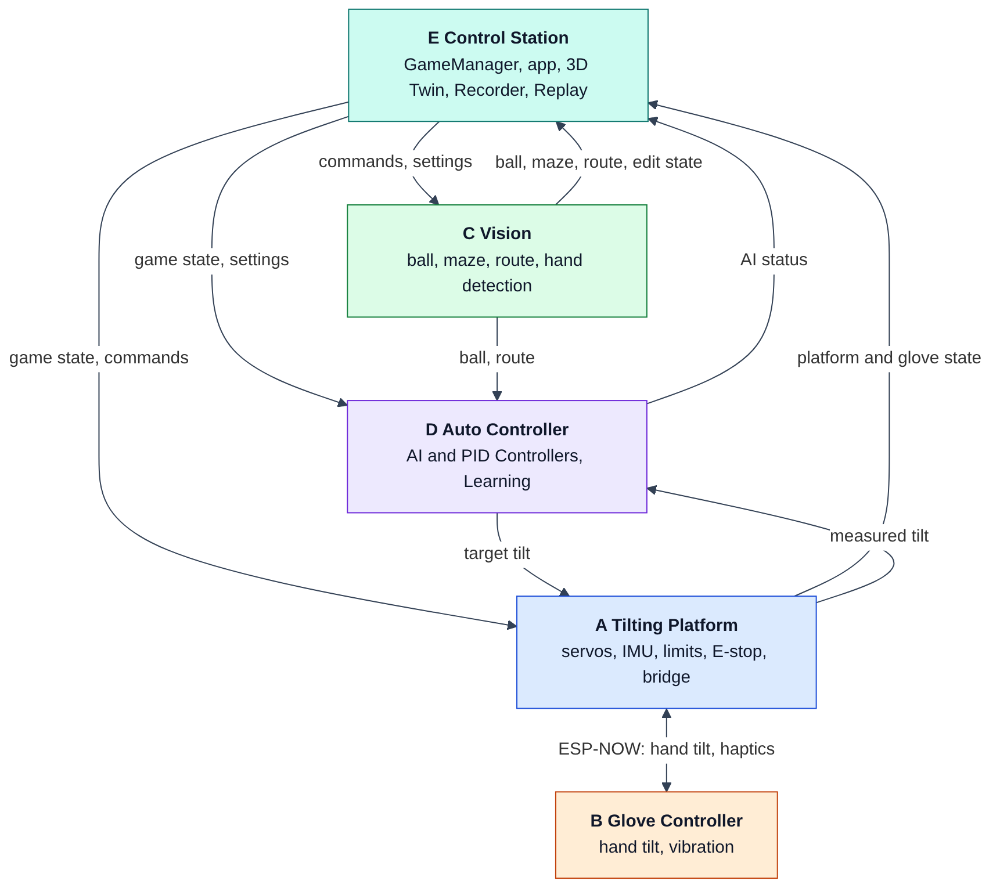

Figure 1 – Logical view: which module uses whose data

The glove talks only to the platform, over ESP-NOW. All other modules exchange messages over the bus. C supplies the ball and the route, D turns them into target tilts, E decides the game state and mode, and A applies only the selected command within its own safety limits.

#### 2.3 Devices and programs

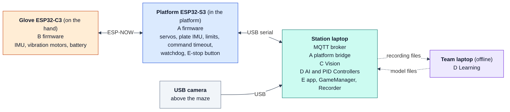

Figure 2 – Device view: what runs where

The laptop runs the platform bridge (A), Vision (C), the Auto Controller runtime (D), the Control Station app with GameManager and Recorder (E) and the MQTT broker. Learning (D) runs offline, never during a game.

#### 2.4 The message bus

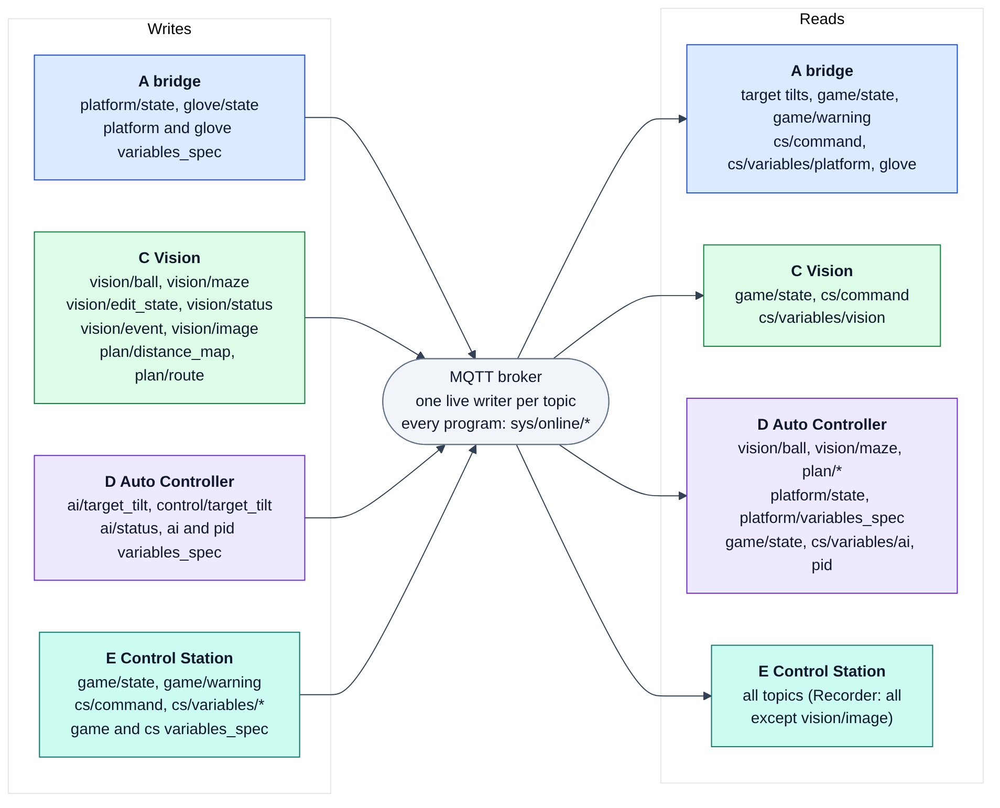

Figure 3 – Bus view: who publishes and who subscribes

Programs on the laptop exchange messages through MQTT. Readers subscribe directly to the topics they need; nothing is forwarded. Every topic has exactly one live writer; replay writes a topic only when its real writer is off. Replay never reaches the motors: the platform bridge, GameManager and the controllers ignore every message whose writer is replay (IF-09). Standalone tests run on a local test broker with no live system.

#### 2.5 Modes

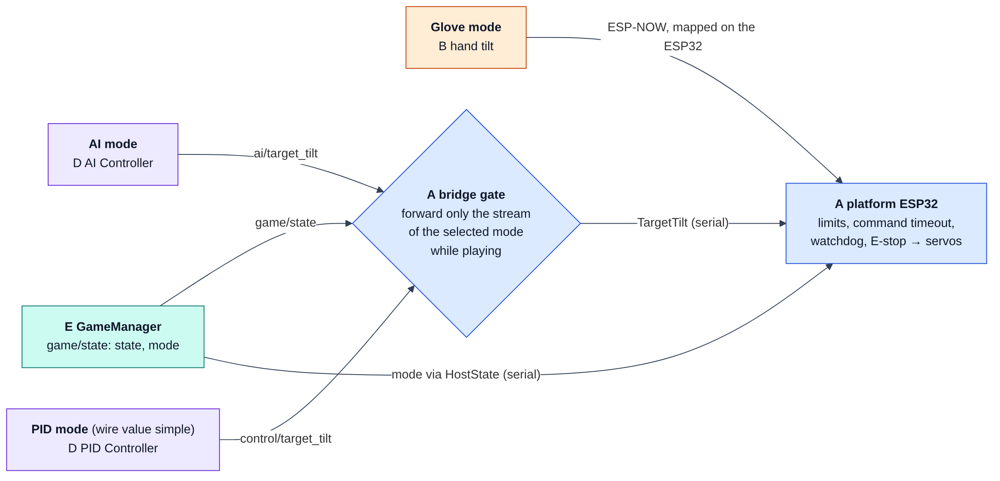

Figure 4 – Modes: who moves the platform

The modes are Glove, AI and PID. On the bus the PID mode is called simple. GameManager (E) selects the mode. In glove mode A maps the hand tilt to the platform. In AI mode D publishes ai/target_tilt, in PID mode control/target_tilt. The platform bridge forwards only the stream of the selected mode while the game is playing, and the ESP32 enforces all limits and the command timeout.

#### 2.6 Flows

The diagrams show the order of the main messages. Payloads and timeouts are defined in the Appendix (IF-01 … IF-09).

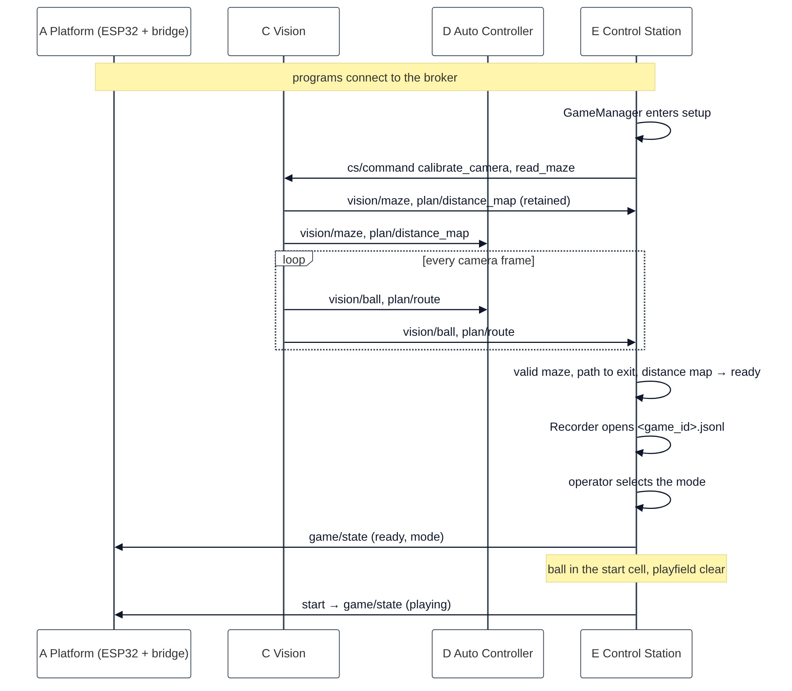

Figure 5 – Start-up and setup

Programs connect and GameManager enters setup. Vision calibrates, reads the maze, publishes the maze, the distance map and the route. GameManager enters ready when these are valid, and the Recorder opens a new game file for the new game_id. The operator selects the mode, places the ball in the start cell and starts.

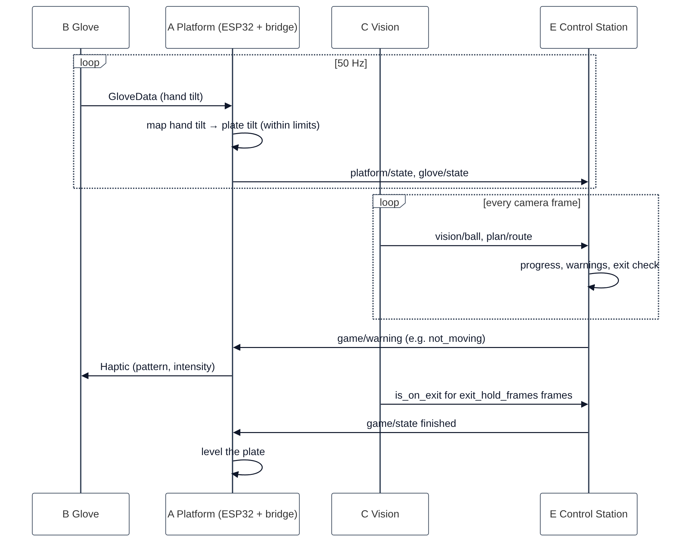

Figure 6 – A game in glove mode

The hand tilt goes to the platform ESP32 about 50 times a second. Vision reports the ball every frame. GameManager updates the progress, sends warnings that become glove vibrations, and finishes the game when the ball has stayed on the exit marker long enough.

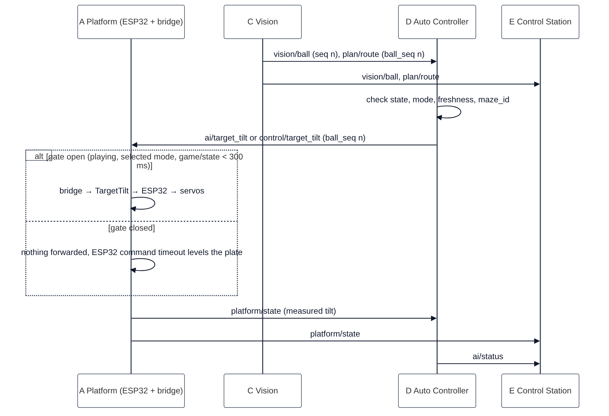

Figure 7 – AI or PID mode, one camera frame

For each camera frame Vision publishes the ball and the route, and the selected controller answers with a target tilt. The bridge forwards it only when the gate is open; otherwise the ESP32 command timeout levels the plate.

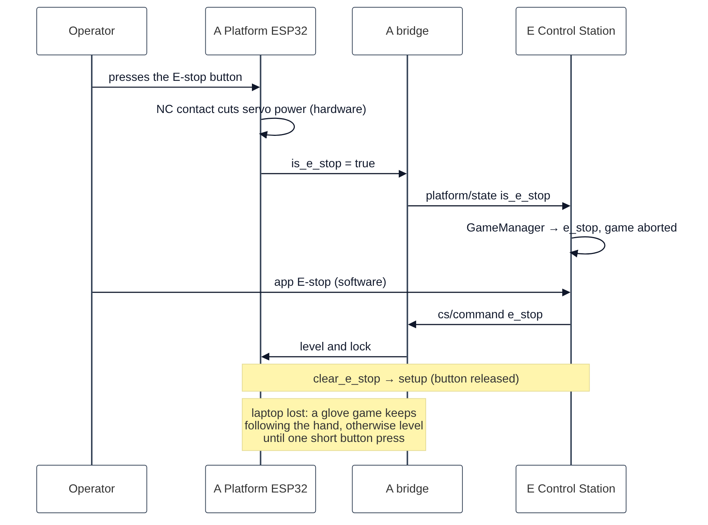

Figure 8 – Safety and lost links

The E-stop button cuts the motor power in hardware and tells the ESP32; the E-stop in the app levels and locks the platform until it is cleared. When the laptop is lost, the platform keeps following the glove only during a glove game; otherwise it levels until one short button press.

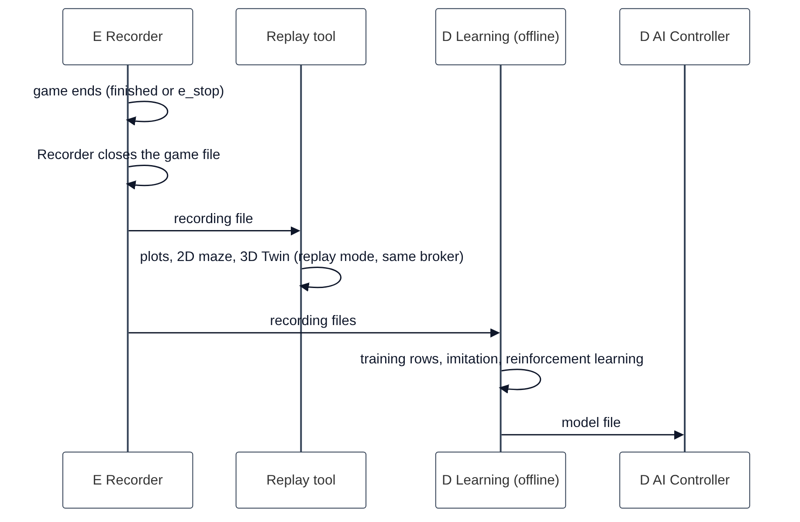

Figure 9 – After the game

Recorder closes the game file. Replay shows a recorded game in the Control Station. Learning reads recording files offline and produces model files for the AI Controller.

### 3. Standalone verification

Every module is demonstrated on December 4 with no other module running. Each module keeps its test inputs in its own fixtures/ folder as plain files (JSON, CSV, recorded video). The instructor can edit these files or give new values, and the test runs again without code changes. Automated tests print pass or fail by themselves for any input the instructor gives; tests that need a person (pressing the E-stop, watching an LED) follow a short checklist. It uses two kinds of checks:

- **Rule checks** that hold for any input and need no expected value, e.g. "no command in paused", "the output stays within ±max_tilt_deg", "every cell of the distance map is 1 + its smallest open neighbour".
- **Reference computation** where an exact number is needed (PID output, the finish frame): the test script computes the expected value itself with a small independent formula.

Fixed expected files are kept only for a few golden examples. Bus inputs are played by the shared playback tool in fixture mode (IF-09), so the instructor edits only the message fields. Layout: <module>/fixtures/<TEST-ID>/ with the input files, a README saying what can be edited, and run_test.py <TEST-ID> printing pass or fail for every check. Windows, plots and mosquitto_sub only show what happens; the pass/fail decision comes from run_test.py. To show that a test can fail, each demo ends with a deliberately broken version of the code (or a wrong input the instructor can check by hand) that gives FAIL.

| Module | Real part in the demo | Test inputs (fixtures) | What is checked |
| --- | --- | --- | --- |
| A Tilting Platform | Platform, servos, IMU, E-stop | Serial test script with target tilts, invalid and stale commands | Platform reaches the targets within limits; invalid commands are rejected; levels on timeout and E-stop |
| B Glove Controller | Glove | Receiver ESP32 test firmware that sends GameInfo at 5 Hz, prints packets and sends haptic commands | 50 Hz tilt packets, vibration patterns, disconnect behaviour |
| C Vision | Camera, test maze plate, ball moved by hand | Maze files with known walls; recorded clips with known ball positions as backup | Ball position, maze scan, distance map and route; hand entry and a changed maze; a maze with no path |
| D Auto Controller | – (software) | Saved AI model; files with ball, route, platform and game state sequences | Target tilts within limits, only in the selected mode; output stops on missing, stale or invalid input |
| E Control Station | – (software) | Fixture publisher script; sample recordings | Game states and commands, warnings, plots, 3D Twin, recording and replay |

On Dec 4 Learning (D) is shown with its own tests in the training environment (D-T1, D-T2, D-T6, D-T7) using a saved model, plus the learning curves; a full training run is not repeated live. The full system, including a maze change during a game, is verified after the module demos (section 9.1).

### 4. Shared conventions (D4)

These rules hold for every message, file and piece of code, so that data means the same thing on both sides of an interface. Units and axis conventions follow ROS REP 103 [1].

| Rule | Content |
| --- | --- |
| Units | The unit is part of every name: _mm, _mm_s, _deg, _deg_s, _s, _ms, _hz, _pct (0–100), _m_s2, _dbm, _v, _cells. A compound unit uses _per_ for division (e.g. pid_kp_deg_per_mm = deg/mm); the short forms _mm_s, _deg_s and _m_s2 are only used for speeds and accelerations (pid_kd_deg_per_mm_s = deg per mm/s). Inside a module any unit is fine (radians in physics, pixels in Vision); values are converted at the boundary. Pixels never leave Vision. |
| Board frame | Origin at the centre of the maze playing area; +x to the right edge as seen by the player, +y to the far edge, +z up. The four ArUco markers on the plate define it. |
| Tilt | tilt_x_deg = positive rotation about +y; tilt_y_deg = negative rotation about +x. So tilt_x_deg > 0 rolls the ball to +x and tilt_y_deg > 0 rolls it to +y. The same rule holds for the hand (hand_tilt_*). Interfaces always use the board frame; if the motors are mounted differently, Platform converts. |
| Cells | {row, col}; row 0 / col 0 at the origin corner of the maze file; rows grow towards +y, columns towards +x. Walls are N/E/S/W flags on cell edges (D14). |
| Envelope | Every bus message is one JSON object with timestamp_s (laptop clock), seq, version and writer, plus its own fields (IF-03). |
| Time | The laptop clock is the only clock; ESP32 and glove data are stamped by the platform bridge when they arrive. Dates for people: ISO 8601 (2026-11-03T14:05:00). |
| Missing values | A field with no value right now is sent as null, never left out. Required fields are never null. |
| Names | "exit", never "goal". Enums are lowercase snake_case strings (playing, e_stop, glove, ai, simple). game_id = time the game entered ready (20261103-140500); maze_id from the maze file; model_version e.g. ppo-20261201-2. |
| Code | PascalCase classes and shared types (BallTracker); snake_case functions, variables and fields (get_maze, x_mm); UPPER_SNAKE_CASE constants (MAX_TILT_DEG); booleans start with is_ / has_. Shared constants live in shared/. Code and comments in English. |
| Versions | version goes up when a payload changes in an incompatible way. Consumers validate the payload version before processing a message. |

### 5. Game states (D5)

Control Station GameManager is the single writer of game/state and game/warning. It runs as a background service in module E, publishes a 10 Hz heartbeat and sends immediate state changes. Closing the UI does not stop GameManager or Recorder.

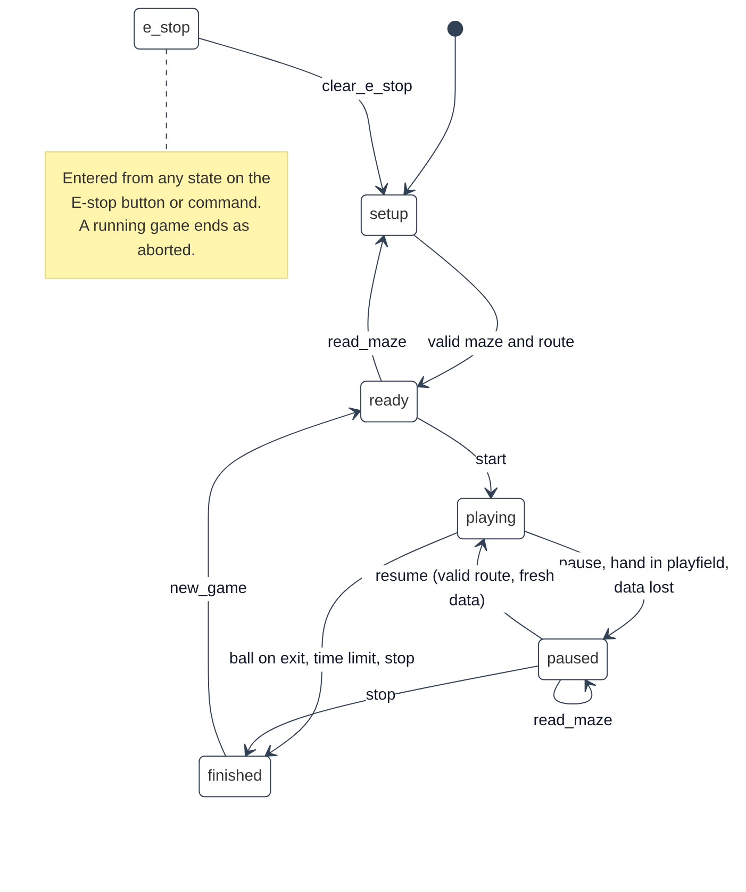

Figure 10 – Game states (UML state machine)

#### 5.1 States

| State | Meaning | Platform |
| --- | --- | --- |
| setup | Waiting for a valid maze | Level |
| ready | Maze and distance map are ready. The ball is placed in the start cell by hand. The glove calibrates here in glove mode. | Level |
| playing | Game running; time, progress and warnings are active | Glove, AI or PID controller, by mode |
| paused | Time and warnings are frozen | Level |
| finished | Game over; time and result are final. The ball stays at the exit. | Level |
| e_stop | Emergency stop | Level and locked |

#### 5.2 Transitions

| From | To | Trigger |
| --- | --- | --- |
| program start | setup | – |
| setup | ready | Valid vision/maze, a path to the exit exists, plan/distance_map is published |
| ready | setup | read_maze |
| ready | playing | start, ball in the start cell, playfield clear (edit_state = clear and sys/online/vision = true, as in 5.3), and the glove connected in glove mode |
| playing | paused | hand entry, occlusion or stale Vision edit state, operator pause; ball lost for ball_lost_pause_s; glove lost for glove_lost_pause_s in glove mode; platform/state lost (any mode); platform fault ≠ none |
| paused | playing | Explicit Resume with all in-game maze change gates satisfied |
| playing | finished | is_on_exit true for exit_hold_frames consecutive frames: result = completed |
| playing | finished | time_limit_s reached, if set: result = timeout |
| playing, paused | finished | stop: result = stopped |
| finished | ready | new_game |
| any | e_stop | e_stop command or is_e_stop; a running game ends with result = aborted |
| e_stop | setup | clear_e_stop, once platform/state shows is_e_stop = false |

During a maze change the game stays in paused; read_maze is accepted there (section 5.5). A new maze_id that arrives in ready (automatic rescan) is handled like read_maze: ready → setup → ready, with a new game_id.

#### 5.3 Rules

- **Mode:** chosen in the Control Station or by a short press on the platform button; GameManager decides. It changes only in setup and ready. Requests during play are refused.

- **Finish:** GameManager decides. While the ball is on the exit marker, Vision sends is_on_exit = true in vision/ball every frame. GameManager counts consecutive frames on every message and resets the count on a false frame. exit_hold_frames is set in tests (about 0.5 s, e.g. 15 frames at 30 fps or 30 frames at 60 fps).

- **Ball lost:** short gaps keep the game running and the Control Station shows "ball not visible". After ball_lost_pause_s (2 s) the game goes to paused. No vision/ball message for the same time counts as lost.

- **Time limit:** time_limit_s is optional and off in normal games. Comparison runs use 120 s (D10, D.9).

- **Warnings:** only in playing. In AI and PID modes they are published for the Control Station, with no vibration.

- **Platform:** the ESP32 stops following the glove and holds level in ready, paused and finished.
- **Resume:** accepted only when all of these hold: edit_state = clear with timestamp_s younger than 2 s and sys/online/vision = true (the same check applies to start); the ball visible and vision/ball younger than 200 ms; platform/state younger than 200 ms with fault = none and is_e_stop = false; a valid route younger than 300 ms whose maze_id matches vision/maze and plan/distance_map; in glove mode the glove connected. Otherwise resume is refused and the Control Station shows which condition is missing.

#### 5.4 Lost links

| Lost | What happens |
| --- | --- |
| Laptop | While playing in glove mode the ESP32 keeps following the hand; otherwise it levels, and one short button press continues with the glove (IF-02). |
| Glove | In glove mode a game cannot start without the glove. If is_glove_connected stays false for glove_lost_pause_s (1 s) during playing, the game goes to paused. |
| Platform data | If platform/state is older than 200 ms, the button is ignored and a playing game goes to paused. |
| GameManager | The bridge closes the gate when the last game/state is older than 300 ms (by its timestamp_s). After a restart the retained playing is not trusted: the old game becomes aborted and GameManager starts in setup. |

#### 5.5 Maze change during a game

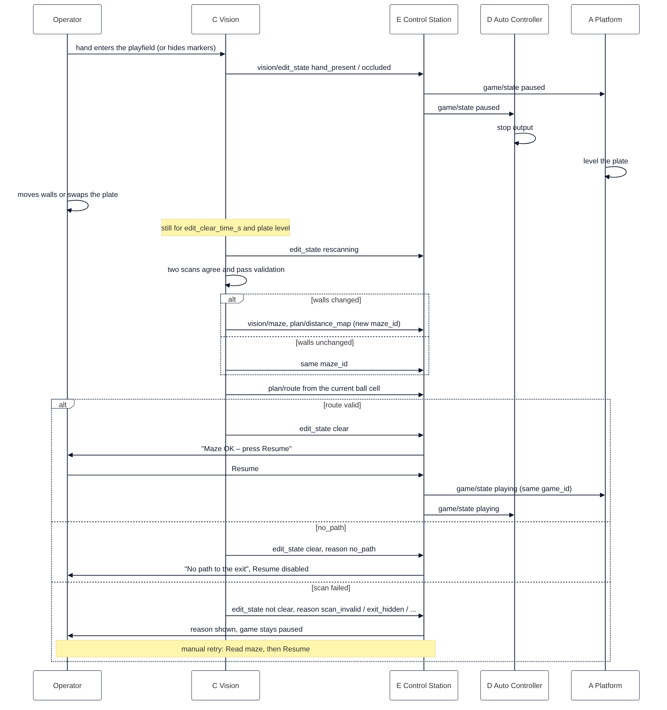

Figure 11 – Maze change during a game

1. **Pause.** Vision publishes vision/edit_state = hand_present when a hand enters the playfield, or occluded when the view is blocked. GameManager pauses at once, also when vision/edit_state is missing or stale. In paused the platform follows no source, not even the glove, and the ESP32 levels the plate. Limits, the command timeout and the E-stop stay active independently. The operator can also press Pause before touching the maze.
2. **Change.** The operator moves snap-in walls or swaps the whole maze plate. Vision keeps reporting hand_present or occluded. The ball may roll; planning always uses the position Vision finds again.
3. **Automatic rescan.** When nothing has moved in the playfield for edit_clear_time_s and the plate is level (below 1° from the markers), Vision sets edit_state = rescanning and reads the maze by itself. Two scans in a row must agree and pass validation. Changed walls give a new maze_id; vision/maze, plan/distance_map and plan/route carry the same maze_id, and routes for the old maze_id are never published again. Unchanged walls keep the maze_id; only the route is computed again from the current ball cell. A valid maze without a path is published with route status no_path.
4. **Ready to continue.** Vision sets edit_state = clear after a valid rescan. If edit_state = clear and reason = null, the Control Station shows "Maze OK – press Resume". If reason = no_path (state clear), it shows "No path to the exit" and keeps Resume disabled. If the state is not clear, it shows the reason (scan_invalid, scan_differs, exit_hidden, plate_not_level, markers_hidden, hand); a ball that is not visible is a resume condition (section 5.3).
5. **Resume.** The game continues only when the operator presses Resume and the resume conditions of section 5.3 hold. The game_id and the elapsed time stay; commands for the old maze are rejected.

**Manual path.** If the automatic rescan fails or hand detection is switched off (edit_detection_enabled = false), the operator uses Pause, changes the maze, presses Read maze (read_maze, accepted in paused) and then Resume. Both paths use the same scan and the same checks.

Hand detection may only pause a game; it never resumes one. A false pause costs one Resume press.

Every maze plate carries its own 4 ArUco markers on its corners, at the same positions on every plate, so a swapped or shifted plate is measured correctly. Walls snap in on the cell edges, so every arrangement is a grid maze; a wall that is not seated shows up as a validation error. Mazes are built with at least two routes from the start to the exit, so that a blocked passage can be bypassed. The maze plate sits on top of the tilting plate and can be swapped as a whole.

### 6. Interfaces

An interface is the agreement about what passes between two modules: messages on the bus, packets on a wireless or serial link, a Python API or a file format. Each interface is owned by the module that provides the data; the modules that use it check that it gives them what they need. This section gives the overview. Every module chapter lists its own inputs and outputs in section X.6, and the full specification (field tables, rates, timeouts and what a reader does when data is missing) is in the Appendix.

#### 6.1 Interfaces at a glance

| IF | Scope | Type | Owner | Users |
| --- | --- | --- | --- | --- |
| IF-01 | Glove ↔ platform packets | ESP-NOW | B | A, B |
| IF-02 | USB serial, platform/state and glove/state | USB serial + bus | A | D, E |
| IF-03 | MQTT envelope and shared helper | Bus rules | Shared | A, C, D, E |
| IF-04 | Vision and planning topics | Bus topics | C | D, E |
| IF-05 | game/state and game/warning | Bus topics | E | A, C, D, E UI |
| IF-06 | AI and PID target commands | Bus topics | D | A, E |
| IF-07 | Commands and component settings | Bus topics | E; specs by each owner | A, C, D, E |
| IF-08 | Learning reset/step boundary | Python API | D internal | D Learning and Evaluator |
| IF-09 | Recordings and Replay | Files | E | E (replay controls), D Learning, shared replay tool |

**Not on the bus:** IF-01 (glove ↔ platform ESP32, ESP-NOW), the serial link in IF-02, IF-08 (training environment, Python API) and IF-09 (recording files). The Recorder subscribes to every topic except vision/image.

#### 6.2 Topics on the bus

| Topic | Writer | Readers | Rate / retained |
| --- | --- | --- | --- |
| game/state; game/warning | E GameManager | A, C, D, E UI | 10 Hz + change / state retained |
| vision/ball | C | D, E | Each frame / no |
| vision/maze; plan/distance_map | C | D, E | Each validated layout / yes |
| plan/route | C | D, E | Each ball sample / no |
| vision/status; vision/event; vision/image | C | E | 1 Hz; event; image rate / status retained |
| vision/edit_state | C | E GameManager | On change + 1 Hz / yes |
| ai/target_tilt; control/target_tilt | D AI / PID | A, E | Each answered sample / no |
| ai/status | D runtime | E | 10 Hz / no |
| platform/state; glove/state | A bridge | D and E; glove to E | 50 Hz / no |
| cs/command; cs/variables/<key> | E UI | Owning component | On action / settings retained |
| \*/variables_spec; sys/online/\* | Owning component | E | On change / yes |

The rates and timeouts in the field tables are the values we design for. Most of them are control variables (IF-07), so they are tuned in tests without changing any interface.

Every program also publishes sys/online/<program> (IF-03); the X.6 tables of the modules do not repeat it.

#### 6.3 Control variables

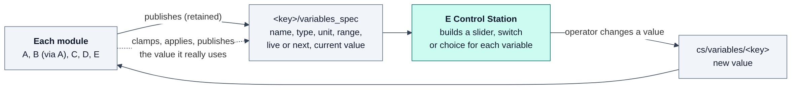

Figure 12 – How control variables reach the Control Station and back

Each module lists its control variables in its variables_spec (IF-07); the Control Station builds a slider, switch or choice for each and sends changes back on cs/variables/<key>. "live" variables change while the system runs; "next" variables take effect at the next start, maze read or game. The full list with meanings is in section X.7 of each module chapter.

#### 6.4 What each interface defines

IF-01 – Glove ↔ Platform (ESP-NOW). The glove sends the hand tilt (GloveData, 50 Hz) and its status (GloveStatus, 1 Hz). The platform sends a heartbeat with the game state and mode (GameInfo) and vibration commands (Haptic). Without GameInfo the glove plays its "disconnected" pattern; without GloveData the platform holds and then levels.

IF-02 – Platform bridge ↔ Platform ESP32. A USB serial link with framed, checksummed packets (COBS + CRC-16). The bridge publishes platform/state and glove/state at 50 Hz and forwards a target tilt only through the gate: state playing, the matching mode and a fresh game/state.

IF-03 – Bus basics. One MQTT broker on the laptop (Mosquitto [2]); every message is a JSON object with the same envelope (timestamp_s, seq, version, writer); topic names, retained topics, delivery levels, sys/online/<program> and the shared helpers.

IF-04 – Vision topics. vision/ball every frame; vision/maze and plan/distance_map for each validated maze; plan/route for each ball sample; vision/edit_state for hand detection; vision/status, vision/event and vision/image. Also the board frame, cells and walls.

IF-05 – Game topics. game/state (state, mode, game_id, maze_id, progress, result) at 10 Hz and on every change; game/warning for not_moving and away_from_exit.

IF-06 – Controller topics. ai/target_tilt and control/target_tilt, each tied to the ball sample it answers; ai/status; the delay budget from camera frame to motor.

IF-07 – Commands and control variables. cs/command (game, safety, Vision and replay commands), cs/variables/<key> and the variables_spec format every module uses.

IF-08 – Learning environment. The reset/step API inside D, with observation and action units and the randomised parameters.

IF-09 – Recordings and replay. One JSONL file per game with every message, the training rows built from it, and playback in the Control Station.

### 7. Decisions

| # | Decision | Result | Status |
| --- | --- | --- | --- |
| D1 | Platform computer | Platform ESP32 + one station laptop | Decided |
| D2 | Glove link | ESP-NOW between the glove ESP32 and the platform ESP32 | Decided |
| D3 | Laptop communication | MQTT bus, one writer per topic | Decided |
| D4 | Shared conventions | Section 4 | Decided |
| D5 | Game states | Section 5 | Decided |
| D6 | Recording and training data | JSONL per game (Recorder); playback tool in shared/ | Decided |
| D7 | Motor type | Two MG996R servos with a separate ≥ 5 A supply; the tilt limit is a control variable (A.7) | Decided |
| D8 | Camera model and mounting | USB camera above the maze centre on the fixed base, 30–60 fps, manual exposure (C.4) | Open – model only |
| D9 | Training environment and 3D view | Learning builds its training environment with ready libraries [3], [4] (Gymnasium API, physics library such as PyBullet); no separate simulator module. Three.js 3D Twin inside the Control Station | Decided |
| D10 | AI approach | Follow the route from Vision; imitation, then reinforcement learning; compared with players and the PID Controller. Targets: ≥ 95 % in the training environment and faster than the PID Controller there; ≥ 7/10 runs within 120 s on the real board | Decided (targets are starting values) |
| D11 | Motor control on the ESP32 | Target tilt as the only input; glove mode without the laptop | Decided |
| D12 | Runtime roles on the laptop | GameManager (game state), platform bridge (gate), Recorder | Decided |
| D13 | Control Station | Electron desktop app [5]; every laptop program runs on Windows and Linux with the same interface | Decided |
| D14 | Maze grid | Cells with walls on edges; maze files in shared/; Vision owns maze reading and route planning | Decided |
| D15 | Modules | Five modules A–E; each demonstrated alone with its own fixtures, which the instructor can edit | Decided |
| D16 | Maze change during a game | Pause, rescan, new maze_id and route, explicit resume (section 5.5); mazes with at least two routes on a removable plate | Decided |

### 8. Budget and weight

| Module | Selected parts (TL) | With alternatives (TL) | Weight (g) | Notes |
| --- | --- | --- | --- | --- |
| A Tilting Platform | 4,500 | 7,000 | 605 | ESP32-S3, 2× MG996R, MPU6050, 2S LiPo battery, servo UBEC, buck converter, E-stop button, mounts. Alternatives: DS3218 servos, BNO055 IMU. |
| B Glove | 1,500 | – | 45 | ESP32-C3, MPU6050, 3 vibration motors + transistors, Li-ion battery + TP4056 |
| C Vision | 4,500 | 1,500 with a 30 fps webcam | 660 (station) | Camera (D8 open, 4,000), stand, printed ArUco markers |
| D, E | 0 | – | – | Software on the station laptop (a team member's laptop) |
| Total | 10,500 | 7,500 – 13,000 | 605 on the platform, plus the maze plate | Selected parts; range = cheaper camera … all alternatives |

Prices are November 2026 estimates from Turkish online shops, not final quotes. Totals are rounded up to the next 500 TL and weights to 5 g, so they can differ slightly from the module part lists; the margin covers the small parts without a price (wires, connectors, capacitor, buttons, LEDs, fuse). The nested-frame mechanism, the servo torque needed and the final moving mass are checked before parts are bought. The maze plates are made by the team (3D printed or cut); their material cost is small and not listed separately. The camera stand is fixed to the stationary structure, not to the tilting plate.

### 9. Demo plan and schedule

December 4 demonstrates each module independently. December 30 validates the integrated physical system, including changed-maze scenarios.

Dec 4 – each module on its own, 3–5 minutes:

| Module | Standalone demo | Local substitutes |
| --- | --- | --- |
| A Tilting Platform | Serial target tilts, MQTT state and a safety case | Serial test script and test publisher |
| B Glove Controller | 50 Hz hand data, haptics and disconnect response | Dedicated receiver ESP32 test firmware |
| C Vision | Live camera on a test maze plate, ball moved by hand: tracking, maze scan, route, hand entry and a changed maze | Maze files with known walls; recorded clips as backup |
| D Auto Controller | Saved-model AI and PID runtime checks and input gating; AI and PID in the training environment (D-T1, D-T2) | Saved model, local targets and broker fixtures |
| E Control Station | Game states, commands, plots, Twin, recording and replay | Own fixture publisher, expected events and sample recording |

#### 9.1 Integration tests after module demos

These tests are not part of the Dec 4 module demos; they run on the whole system after the module demos.

| ID | Scenario | Required evidence |
| --- | --- | --- |
| INT-01 | Integrated Glove, AI and PID modes | Commands follow only the selected source; with the real glove the plate follows the hand within ±3°; A-T5 passes |
| INT-02 | Unseen maze before start | New geometry is scanned and a valid route reaches the exit with a previously trained model |
| INT-03 | Maze edit during a game | Hand detection pauses the game. Platform levels. After rescan and explicit Resume, planning starts from the current ball position. Old route and commands are rejected |
| INT-04 | Edited maze has no valid path | Game remains paused and outputs stay disabled |
| INT-05 | Record and replay a changed-maze game | Correct maze_id, ball and tilt shown during replay; the platform does not move |
| INT-06 | Safety during a game: physical E-stop; camera, glove or laptop lost | Power is cut or the plate goes level; the game enters e_stop or paused; the event is in the recording |
| INT-07 | AI on the real maze | ≥ 7 of 10 runs reach the exit within 120 s (D10) |

The layouts, trial counts and success rates for INT-02 and INT-03 are set when the platform is built. They are reported separately from the fixed-maze targets of D.

### 10. System risks

| Risk | Likelihood | Impact | What we do if it happens |
| --- | --- | --- | --- |
| Hardware arrives late | medium | high | Modules demo with their own fixtures; the AI trains in the training environment |
| Training environment differs from the real platform | high | medium | Randomise the environment, tune it with recordings, same filter and delay as the real system; the PID controller as the comparison baseline |
| Camera delay, blur or lighting | medium | high | Fixed exposure, diffuse light, low max tilt; delay measured and used in training; faster camera only if needed |
| One laptop runs everything | medium | medium | Measure CPU; no training during games; lower camera resolution if needed |
| Servo backlash and precision | medium | medium | Measure with the plate IMU; DS3218 as the alternative |
| Two programs write the same topic | low | medium | writer field in every message; the Control Station health panel warns; stand-ins only with the real program off |
| Motor power problems (brown-outs) | medium | high | Separate servo supply, capacitor, common ground; E-stop button on the servo line |

## Part II – Modules

### A – Tilting Platform

| Property | Design |
| --- | --- |
| Runs on | Platform ESP32; platform bridge on the station laptop |
| Languages | C++ (PlatformIO) on the ESP32; Python for the bridge |
| Interfaces | IF-02 · IF-01 |

#### A.1 Purpose and scope

A uses a nested-frame mechanism inspired by the classic Labyrinth game: a fixed outer frame, a middle frame that rotates around one axis, and an inner tilting plate that rotates around the perpendicular axis. Two servos mounted on the sides drive these axes through mechanical couplings. The ESP32-S3 controls both servos, reads the IMU on the moving plate, and enforces the tilt limits, the E-stop, the 200 ms command timeout and the software watchdog. Clearances and the servo torque needed are checked on the first prototype build. A also includes the Python platform bridge on the laptop, which connects the ESP32 over USB serial to the MQTT bus.

A removable maze plate sits on top of the tilting plate. It can be removed and replaced without taking the two-axis mechanism apart, so the maze can be changed by swapping the plate (section 5.5). The maze walls are separate 3D-printed snap-in pieces on the grid edges of the plate; they can be moved to build different layouts. Four ArUco markers sit at fixed corner positions on every maze plate. After a plate or layout change, the game is paused while the camera reads and validates the new maze.

#### A.2 Requirements

| ID | Requirement | Target | How we check it |
| --- | --- | --- | --- |
| A-R1 | Tilt the platform along two axes. | Reach a target tilt within ±1° in 1 s on both axes, never beyond max_tilt_deg or faster than max_tilt_speed_deg_s. | Compare IMU measurements with the physical platform angle |
| A-R2 | Follow glove movements in glove mode. | The plate follows the hand tilt (after glove_gain and glove_deadzone_deg) within ±3°, never beyond max_tilt_deg. | Inject recorded GloveData over the serial port (test build) and compare glove/state with platform/state. |
| A-R3 | Receive and execute tilt commands from the laptop. | Apply valid TargetTilt commands; drop every command that breaks a gate rule (game/state older than 300 ms, wrong mode or state, other maze_id, writer = replay); reject NaN and broken frames; clamp out-of-range targets to max_tilt_deg (visible in applied_tilt). | Send test commands through the Platform Bridge and observe the platform response. |
| A-R4 | Report platform and glove status to the laptop. | Publish platform/state and glove/state at ≥ 48 Hz with no gap above 60 ms. | Monitor MQTT messages and verify their frequency and fields |
| A-R5 | Enter a safe state when control or communication fails. | In AI/PID mode, the command timeout fires 200 ms after the last valid command and the plate is below 1° tilt within 1 s after that; level and lock the platform when a software E-stop is triggered; the E-stop button cuts servo power and sets is_e_stop. | Interrupt communication and trigger E-stop to verify the platform response. |

#### A.3 Module diagram

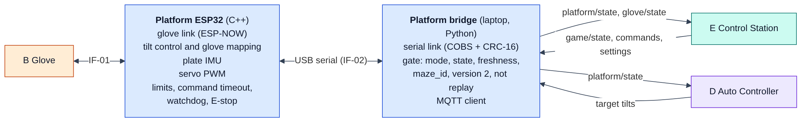

Figure 13 – A Tilting Platform: parts and connections

#### A.4 Hardware

| Part | Model | Qty | Price (TL) | Weight (g) | Why this part |
| --- | --- | --- | --- | --- | --- |
| Main Controller | ESP32-S3 DevKitC-1 N16R8 | 1 | 600 | 12 | Main controller for servo control, sensor reading and safety functions. |
| Servo Motor | TowerPro MG996R | 2 | 440 (2 × 220) | 110 (2 × 55) | Primary choice for controlling the two tilting axes. Metal gears and integrated position control. |
| Backup Servo Motor | DS3218 (180°) | 2 | 2,000 (2 × 1,000) | 120 (2 × 60) | Alternative if MG996R does not provide sufficient torque. Backup option; excluded from initial total. |
| IMU | MPU6050 (GY-521) Alternative: BNO055 | 1 | 200 Alternative: 1,200 | 3 | Measures platform acceleration and angular velocity to estimate tilt. |
| Battery | 2S LiPo, 7.4 V, 1500–2200 mAh | 1 | 1,500 | 100 | Main power source for the platform. |
| Servo Voltage Regulator | UBEC, 6 V, target 8 A continuous | 1 | 1,400 | 35 | Provides a regulated power supply for both servo motors. |
| DC-DC Buck Converter | LM2596 adjustable step-down | 1 | 50 | 15 | Converts battery voltage to regulated 5 V for the ESP32-S3. |
| Electrolytic Capacitor | 1000 µF, at least 10 V | 1 | - | - | Helps reduce voltage fluctuations caused by sudden servo current demands. |
| Emergency stop button | 22 mm mushroom, latching (turn to release), 1NO + 1NC | 1 | - | - | NC contact disconnects servo power; NO contact is read by the ESP32 (is_e_stop). |
| Main Power Switch | DC-rated ON/OFF switch | 1 | - | - | Controls the main battery power connection. |
| Fuse and Fuse Holder | DC-rated inline fuse | 1 set | - | - | Protects the power circuit against excessive current. |
| Mode Button | Panel-mount push button | 1 | - | - | Allows the user to change the platform operating mode. |
| Status LED | 5 mm LED + resistor | 5 | - | - | Indicates platform status and operating mode. |
| Tilting Mechanism | Nested-frame mechanism (Labyrinth-style) | 1 set | - | 150 | Provides two-axis mechanical movement. |
| Tilting Platform Plate | Lightweight 3D-printed or plywood support plate, approx. 30 × 30 cm | 1 | - | 150 | Supports the removable maze plate and transfers the tilting motion. |
| Removable Maze Plate | Lightweight 3D-printed plate with fixed ArUco marker positions | 1 or more | - | - | Different mazes can be installed without changing the tilting mechanism. |
| Maze Walls | 3D-printed snap-in wall pieces | 1 set per maze | - | - | Define the maze paths; can be rearranged or replaced to build other layouts. |
| Servo Mounting Parts | Custom brackets, horns and shaft couplings | 2 sets | 200 | 30 | Connects each servo to the corresponding mechanical axis. |
| Total |  |  | 4,500 (7,000 with the DS3218 / BNO055 alternatives) | 605 |  |

The support plate and the removable maze plates are made by the team by 3D printing or from light sheet material. Each maze plate has snap-in walls and four ArUco markers at fixed corner positions. Their material cost is low and is not listed separately in this estimate.

#### A.5 Software design

| Class | Responsibility (one sentence) | Main public methods |
| --- | --- | --- |
| PlatformController | Controls platform tilt and operating modes. | setTargetTilt(), updateMode(), update() |
| MotorController | Sends position (PWM) commands to the two servos. | setMotorOutput(), stopMotors(), levelPlatform() |
| IMUHandler | Reads and processes platform orientation data. | readIMU(), getTilt() |
| SafetyManager | Handles emergency stop, the 200 ms command timeout, the software watchdog and safe-state transitions. | triggerEStop(), checkCommandTimeout(), checkWatchdog(), enterSafeState() |
| GloveHandler | Receives glove data and sends haptic commands via ESP-NOW. | processGloveData(), sendHaptic() |
| SerialHandler | Handles framed USB serial communication between ESP32 and Platform Bridge. | sendFrame(), receiveFrame() |
| PlatformBridge | Connects ESP32 serial messages with the MQTT bus. | start(), handleSerialMessage(), handleMQTTMessage() |
| MQTTHandler | Publishes platform/state and glove/state and receives platform commands through MQTT. | publishState(), subscribeTopics(), publishVariablesSpec() |

The ESP32 continuously reads IMU data, processes glove and serial messages, checks safety conditions, determines the active control mode, and updates the motor outputs. Platform state and glove data are periodically transmitted to the Platform Bridge.

The Python Platform Bridge continuously handles USB serial and MQTT communication. It forwards ESP32 status messages to MQTT and validates incoming commands before forwarding them to the ESP32. AI and PID tilt commands are sent only when the corresponding mode and game-state conditions are satisfied.

#### A.6 Inputs and outputs

| Direction | Message or topic | From / to | Rate | Interface |
| --- | --- | --- | --- | --- |
| In | GloveData, GloveStatus | from B | 50 Hz, 1 Hz | IF-01 |
| Out | GameInfo, Haptic | to B | 5 Hz, on warning | IF-01 |
| In | ai/target_tilt, control/target_tilt | from D | each ball sample | IF-06 |
| In | game/state, game/warning | from E | 10 Hz + changes, on event | IF-05 |
| In | cs/command (e_stop, clear_e_stop, calibrate_glove), cs/variables/platform, cs/variables/glove | from E | on action | IF-07 |
| Out | platform/state, glove/state | to D, E | 50 Hz | IF-02 |
| Out | platform/variables_spec, glove/variables_spec | to E | on change | IF-07 |
| Inside A | TargetTilt and state frames between bridge and ESP32 | USB serial | 50 Hz | IF-02 |

A owns IF-02. It uses IF-01 (owned by B), IF-05, IF-06 and IF-07.

#### A.7 Control variables

| Name (unit in the name) | Live? | Meaning |
| --- | --- | --- |
| max_tilt_deg (deg) | yes | Maximum allowed platform tilt angle. |
| max_tilt_speed_deg_s (deg/s) | yes | Maximum platform tilt speed. |
| glove_gain | yes | Controls the sensitivity of platform response to glove movements. |
| glove_deadzone_deg (deg) | yes | Minimum glove angle required to generate platform movement. |
| serial_port (choice) | yes | Serial port of the ESP32, chosen from the ports the bridge finds (e.g. COM3 or /dev/ttyUSB0); starts from a config file; the bridge reopens the port. |

#### A.8 Errors and safety

| What can go wrong | How we detect it | What the module does |
| --- | --- | --- |
| IMU failure | Invalid or missing sensor data | Stop normal control and enter safe state. |
| Motor failure | Servo does not reach the angle (the plate IMU differs from the target) | Stop motor outputs and report fault. |
| Glove disconnection | No GloveData received within 300 ms | Stop following glove commands and level the platform if control is available; GameManager pauses the game after glove_lost_pause_s (1 s). |
| Laptop disconnection | No HostState (serial) received within 300 ms | Glove mode: keep following the hand only if the last state was playing, otherwise level; AI/PID modes enter safe state. |
| TargetTilt timeout | No valid command received within 200 ms (command timeout) | Level the platform in AI/PID mode: below 1° tilt within 1 s after the timeout. |
| Serial communication failure | Invalid frames or serial connection loss | Reject invalid frames and attempt reconnection. |
| Software E-stop | E-stop command received | Level the platform and lock motor control. |
| Physical E-stop | E-stop button pressed | Motor power is cut independently of ESP32 software; the ESP32 reads the second contact and reports is_e_stop = true. |

#### A.9 Tests and Dec 4 demo

| Test | Requirement ID | Method | Pass if (target) |
| --- | --- | --- | --- |
| A-T1 Two-axis tilt | A-R1 | Command different X and Y tilt angles and measure the platform using the IMU. | The platform reaches the requested angles within the defined limits. |
| A-T2 Glove control | A-R2 | Recorded GloveData for both axes injected over the serial port (test build); compare glove/state with platform/state. | The plate follows the hand tilt within ±3° and never exceeds max_tilt_deg |
| A-T3 Laptop commands | A-R3 | Send valid, invalid and outdated TargetTilt commands through the Bridge. | Valid commands are applied; invalid and outdated commands are rejected. |
| A-T4 State publishing | A-R4 | Monitor platform/state and glove/state MQTT messages. | Both topics have the IF-02 fields, ≥ 48 Hz, no gap above 60 ms. |
| A-T5 Safe state | A-R5 | Stop the command stream; send the software E-stop; press the physical E-stop button. | Below 1° within 1 s after the command timeout; software E-stop levels and locks; the button cuts servo power and sets is_e_stop. |

The Dec 4 demo runs only A, its serial test script and a local broker. A-T2 uses recorded GloveData packets that the test script injects over the serial port (a debug command in the test build only); control with the real glove is part of INT-01 after the module demos.

- Show the physical two-axis platform and its movement.

- Send target tilts from a test script over the serial link and show the platform following them.

- Connect the laptop and show Platform Bridge communication through MQTT.

- Show platform state updates on the bus with mosquitto_sub.

- Demonstrate one safety scenario, such as communication loss or software E-stop.

#### A.10 Risks and fallback

| Risk | Likelihood | Impact | Fallback |
| --- | --- | --- | --- |
| IMU readings are unstable | Medium | High | Apply filtering and recalibrate the sensor. |
| Motor control is unreliable | Medium | High | Test motors and drivers separately; reduce movement speed. |
| Glove communication is interrupted | Medium | Medium | Detect timeout and switch to safe behavior. |
| USB serial communication fails | Medium | High | Reconnect the serial port; retain local glove control. |
| MQTT communication fails | Medium | High | Continue independent local operation in glove mode. |
| Full integration is delayed | Medium | High | Prioritize control from the test script and basic safety functions for the demo. Verify control with the real glove in INT-01. |

### B – Glove Controller

| Property | Design |
| --- | --- |
| Runs on | Glove ESP32-C3 |
| Languages | C++ (PlatformIO) |
| Interfaces | IF-01 |

#### B.1 Purpose and scope

The Glove module is a wireless, wearable controller that captures the player's hand pitch and roll and transmits it to the platform ESP32 via ESP-NOW. It also receives game state and warning messages from the platform to provide haptic vibration feedback to the player. It only handles data acquisition and haptics; it does not calculate the physical mapping of hand tilt to motor angles, which is handled entirely by the platform.

#### B.2 Requirements

| ID | Requirement | Target | How we check it |
| --- | --- | --- | --- |
| B-R1 | Send the hand tilt to the platform without cables | 50 ± 2 Hz, ≤ 2 % packet loss at 1 m, delay ≤ 30 ms (95th percentile) | Round-trip time: the receiver echoes every 10th packet; delay = RTT/2 |
| B-R2 | Provide physical game warnings | Play specific vibration patterns within 100 ms of receiving a Haptic message | The glove logs the packet arrival and the motor-on time with micros() |
| B-R3 | Measure the hand tilt from the calibrated zero | After calibration the held position reads 0 ± 1°; tilting gives the right sign on each axis | Calibrate, tilt the hand in four directions, calibrate again in another position |
| B-R4 | Safe behaviour when the platform link is lost | Plays the "disconnected" pattern within 1 s; keeps sending GloveData | Stop GameInfo on the receiver |

#### B.3 Module diagram

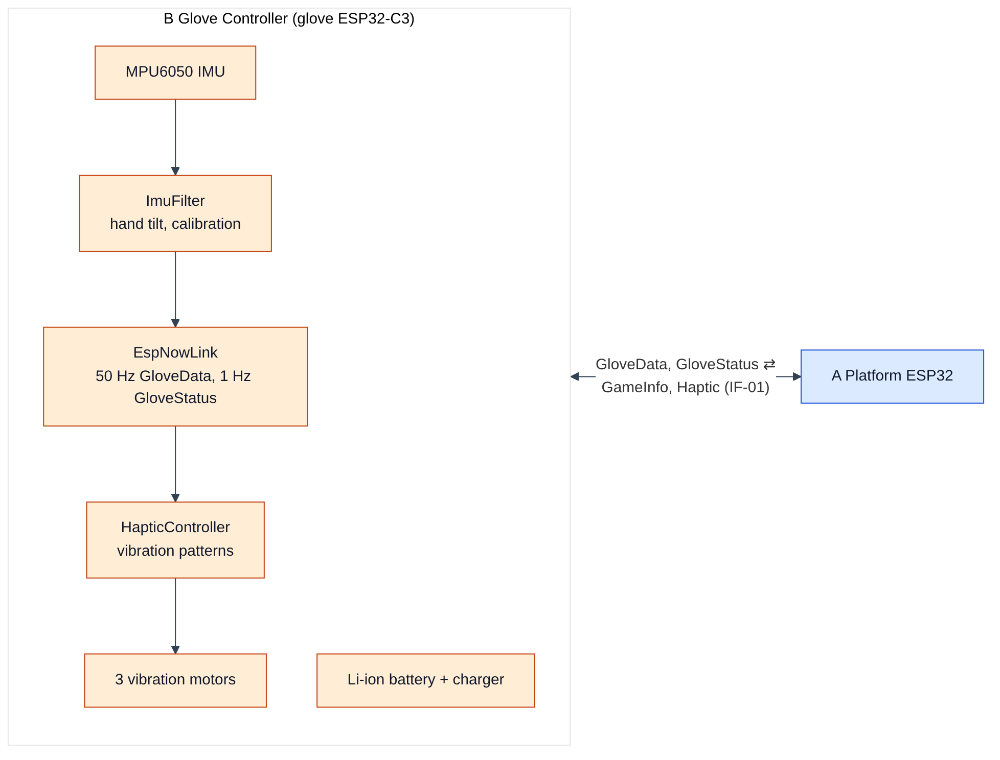

Figure 14 – B Glove Controller: parts and connections

#### B.4 Hardware

| Part | Model | Qty | Price (TL) | Weight (g) | Why this part |
| --- | --- | --- | --- | --- | --- |
| Controller | ESP32-C3 | 1 | 200 | 5 | Has Wi-Fi/ESP-NOW, compact size for wearable, natively supported by PlatformIO |
| Gyroscope | MPU6050 | 1 | 150 | 3 | Standard 6-axis IMU for reliable tilt reading |
| Vibration | ERM Motor + Transistor | 3 | 450 (3 × 150) | 5 | Provides haptic vibration |
| Battery | 3.7V Li-ion Battery & TP4056 Charger Module | 1 | 500 | 30 | Required for wireless operation |
| Total |  | 6 | 1,500 | 45 |  |

#### B.5 Software design

| Class | Responsibility (one sentence) | Main public methods |
| --- | --- | --- |
| ImuFilter | Turns IMU readings into calibrated hand tilt | update(ax_m_s2, …, dt_s: float) -> (tilt_x_deg, tilt_y_deg); calibrate() -> bool |
| HapticController | Plays the vibration patterns. | play_pattern(pattern_id: uint8, intensity_pct: uint8, duration_ms: uint16) -> void |
| EspNowLink | Manages the wireless packets: every 20 ms (50 Hz) reads the IMU, updates the filter and sends GloveData; triggers HapticController on a Haptic packet; triggers the "disconnected" pattern when GameInfo is missing for 1 s | begin() -> bool; send_glove_data(data) -> bool; on_receive(packet) -> void |

#### B.6 Inputs and outputs

| Direction | Message or topic | From / to | Rate | Interface |
| --- | --- | --- | --- | --- |
| In | Hand motion | MPU6050 on the glove | 50 Hz | – |
| Out | GloveData (hand tilt) | to A | 50 Hz | IF-01 |
| Out | GloveStatus (battery, firmware version) | to A | 1 Hz and on change | IF-01 |
| In | GameInfo (heartbeat: state, mode, vibration settings, calibration request) | from A | 5 Hz and on change | IF-01 |
| In | Haptic (pattern, intensity, duration) | from A | on warning | IF-01 |
| Out | Vibration | to the player | on Haptic | – |

B owns IF-01. B never talks to the laptop; the platform bridge publishes the glove's data as glove/state.

#### B.7 Control variables

| Name (unit in the name) | Live? | Meaning |
| --- | --- | --- |
| is_vibration_enabled (bool) | yes | Toggles haptic feedback on/off. |
| vibration_intensity_pct (%) | yes | Master volume for vibration strength. |
| filter_strength | yes | Smoothing factor for IMU noise. |

#### B.8 Errors and safety

| What can go wrong | How we detect it | What the module does |
| --- | --- | --- |
| Platform Disconnected | No GameInfo received for 1 second | Play one long vibration pulse and keep sending GloveData. |
| IMU I2C Failure | Failed I2C read timeout | Send 0 tilt (level) to prevent wild platform swings and play one long vibration pulse. |

#### B.9 Tests and Dec 4 demo

| Test | Requirement ID | Method | Pass if (target) |
| --- | --- | --- | --- |
| B-T1 Rate and delay | B-R1 | 60 s at 1 m; the receiver counts packets and echoes every 10th one | 50 ± 2 Hz, ≤ 2 % loss, 95th percentile of RTT/2 ≤ 30 ms |
| B-T2 Vibration patterns | B-R2 | The receiver sends the Haptic patterns from haptic_cases.csv; the glove logs arrival and motor-on times | ≤ 100 ms from arrival to motor on; with is_vibration_enabled = false the motor stays off |
| B-T3 Disconnect | B-R4 | The receiver stops sending GameInfo but keeps listening | Within 1 s the glove plays the "disconnected" pattern; GloveData keeps arriving |
| B-T4 Calibration and signs | B-R3 | calibrate_request raised (long press, calibrate_glove, or the receiver board on Dec 4) with the hand in a position; tilt forward, back, left and right; calibrate again in another position | The held position reads 0 ± 1°; each tilt changes the right axis with the right sign; after the second calibration the new position reads 0 ± 1° |

**Stand-ins:** a test ESP32 replaces the platform; no laptop is needed.

Demo on Dec 4 (3–5 min): the glove sends the hand tilt at 50 Hz to a receiver ESP32 (a test board or the platform ESP32), which sends GameInfo at 5 Hz and prints the tilt and the arrival time; then the receiver sends Haptic packets and the glove plays each vibration pattern; the glove is calibrated with a long press and the hand is tilted in four directions; finally the receiver stops sending GameInfo and the glove plays the "disconnected" pattern while it keeps sending.

#### B.10 Risks and fallback

| Risk | Likelihood | Impact | Fallback |
| --- | --- | --- | --- |
| ESP-NOW packet loss in a noisy 2.4GHz Wi-Fi environment | HIGH | Medium (jittery platform movement) | Implement a simple moving average filter on the platform side to smooth out missing data frames. |
| IMU gyro drift over a long session | Medium | Medium (hand is flat but platform tilts) | Rely on the long-press calibration feature in GameInfo to reset the zero point outside playing. |

### C – Vision

| Property | Design |
| --- | --- |
| Runs on | Station laptop (own process) |
| Languages | Python (OpenCV, NumPy) |
| Interfaces | IF-04 |

#### C.1 Purpose and scope

C turns the camera image into data for the rest of the system. It finds the ball and its speed, reads the maze walls, the start and the exit, plans the route from the ball to the exit and notices when a hand enters the playfield. It publishes the ball state, the maze, the distance map, the route and the edit state. Pixels never leave Vision. C does not decide the game state (E does) and never moves the platform.

#### C.2 Requirements

| ID | Requirement | Target | How we check it |
| --- | --- | --- | --- |
| C-R1 | Report the ball position | ≥ 20 Hz, error ≤ 3 mm | Ball at known positions, live and in recorded video |
| C-R2 | Low delay | frame_age_ms < 40 ms | Logged frame_age_ms |
| C-R3 | Read the maze | All walls, start and exit correct in ≥ 8 of 10 scans; a scan that fails validation or differs between two scans in a row is never published; a scan that differs from the maze file is published and marked (maze_match = none) | 10 scans per test maze |
| C-R4 | Detect the ball on the exit | is_on_exit true while the ball centre is inside the marker; false 5 mm outside | Ball placed on and next to the marker |
| C-R5 | Handle a lost ball | is_visible = false within lost_timeout_ms (200 ms); tracking back within 3 frames | Ball covered by hand |
| C-R6 | Detect wall hits | ≥ 80 % of hits found, ≤ 1 false hit per minute | Recorded games, hits labelled by hand from the video |
| C-R7 | Plan the route | Correct distance map and route on known mazes; no_path when the exit cannot be reached | Five maze files with known answers, one without a path |
| C-R8 | Handle a maze change | hand_present within 0.5 s of a hand entering; after the change a new maze_id and a new route, or no_path; old routes never published again | Hand entry and wall changes on the test maze |
| C-R9 | No false pauses | 0 hand_present in 5 minutes of normal play (plate tilting up to max_tilt_deg, people around the table) | Recorded play clips without hands, played back through Vision |

#### C.3 Module diagram

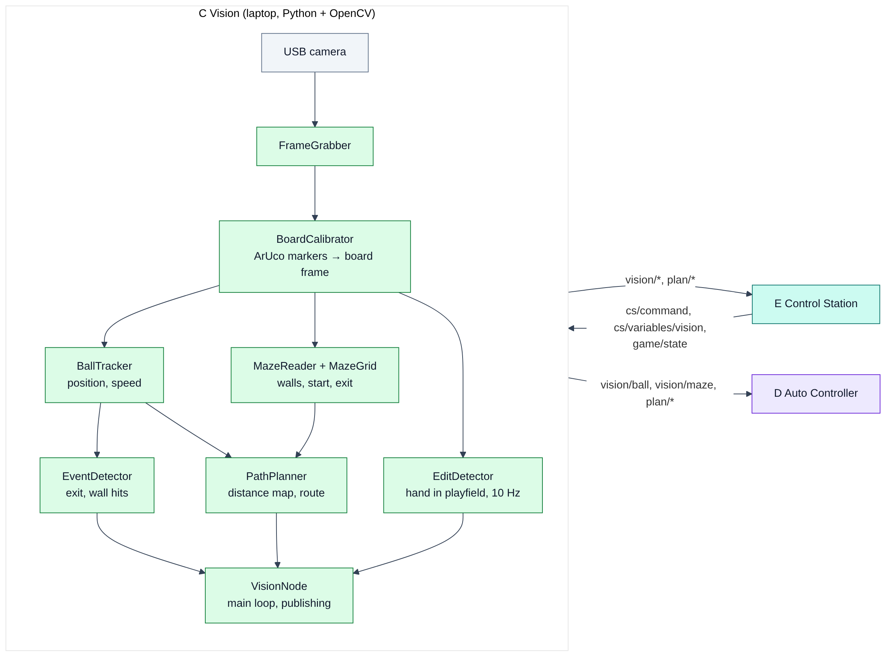

Figure 15 – C Vision: parts and connections

#### C.4 Hardware

Parts for one station. The camera is a UVC USB camera with 30–60 fps and manual exposure (D8); the code works with any such camera. Wiring: the camera connects to the station laptop by USB.

| Part | Model | Qty | Price (TL) | Weight (g) | Why this part |
| --- | --- | --- | --- | --- | --- |
| Camera | USB camera, 30–60 fps (D8) | 1 | 4,000 | 150 | Sees the whole maze from above; 30–60 fps, manual exposure |
| ArUco markers | 4×4 dictionary, IDs 0–3, 30–40 mm, printed on matte paper | 4 per maze plate | 0 | 10 | Board-frame reference on the corners of every maze plate |
| Test maze plate | Made by the team: a plate with its own 4 markers, a few snap-in walls and an exit marker | 1 | 0 | – | Dec 4 demo and all Vision tests without module A |
| Camera stand | Desk clamp overhead stand | 1 | 500 | 500 | Holds the camera fixed above the maze centre, off the tilting plate |
| Total |  |  | 4,500 | 660 |  |

#### C.5 Software design

Python 3.11, OpenCV (with cv2.aruco), NumPy and paho-mqtt through the shared bus helper (shared/bus/). The maze format and helper live in shared/mazes/ and are owned by Vision.

| Class | Responsibility (one sentence) | Main public methods |
| --- | --- | --- |
| VisionNode | Main program: runs the frame loop, applies the game-state rules and publishes all vision/\* topics | run() -> None; on_command(msg: dict) -> None; on_variables(msg: dict) -> None |
| FrameGrabber | Reads frames from a frame source (USB camera, recorded clip with arrival times, or a generated test scene); in record mode it saves frames and arrival times for tests | open(camera_index: int) -> bool; read() -> (frame, t_arrival_s: float) \| None; set_exposure(exposure: float, gain: float) -> None |
| BoardCalibrator | Finds the 4 ArUco markers, keeps the pixel → board homography and runs calibrate_camera | update(frame) -> bool; to_board_mm(u_px: float, v_px: float) -> (x_mm: float, y_mm: float); calibrate(frame) -> (reprojection_error_mm: float, camera_height_mm: float) |
| BallTracker | Finds the ball by colour, corrects the parallax and filters position and speed | update(frame, t_s: float) -> BallState (x_mm, y_mm, vx_mm_s, vy_mm_s, is_visible, is_predicted, meas_x_mm, meas_y_mm) |
| EventDetector | Decides is_on_exit in each frame and detects wall hits | update(state: BallState, maze: MazeGrid) -> (is_on_exit: bool, events: list[dict]) |
| MazeReader | Scans walls, start and exit with the plate flat and compares the scan with the maze files | scan(frame) -> MazeGrid \| None; match(scan: MazeGrid, files: list[MazeGrid]) -> MazeGrid \| None |
| MazeGrid (shared/mazes/) | Maze format and helper shared with the other modules | load(path: str) -> MazeGrid; save(path: str) -> None; validate() -> bool; cell_centre_mm(row: int, col: int) -> (x_mm, y_mm); cell_of(x_mm: float, y_mm: float) -> (row, col); to_ascii() -> str |
| OverlayRenderer | Draws walls, exit, ball and markers on a small copy of the frame and encodes it as JPEG | render(frame, state: BallState, maze: MazeGrid) -> bytes |
| PathPlanner | Calls the shared maze helper (shared/mazes/) to build the distance map and the next route points from the ball cell | build(maze: MazeGrid) -> int[rows][cols]; route(ball: BallState) -> Route; invalidate() -> None |
| EditDetector | Detects a large foreign object in the playfield and decides when it is still again; runs on a 160×120 rectified copy at edit_rate_hz in its own thread, so ball tracking keeps its frame rate | update(frame, markers_found: int) -> state |

ArUco detection and camera calibration follow the OpenCV tutorials [6].

Each frame VisionNode updates the calibration, the ball state, the events and the edit state, then asks PathPlanner for the route for that ball sample. read_maze is accepted in setup, ready and paused, with the board level. A changed maze gets a new maze_id and makes the old route invalid; no_path and a failed scan keep automatic play blocked.

#### C.6 Inputs and outputs

| Direction | Message or topic | From / to | Rate | Interface |
| --- | --- | --- | --- | --- |
| In | Camera frames | USB camera | 30–60 Hz | – |
| In | cs/command (read_maze, calibrate_camera), cs/variables/vision | from E | on action | IF-07 |
| In | game/state | from E | 10 Hz + changes | IF-05 |
| Out | vision/ball | to D, E | every frame | IF-04 |
| Out | vision/maze, plan/distance_map | to D, E | each validated maze (retained) | IF-04 |
| Out | plan/route | to D, E | every frame with a valid maze | IF-04 |
| Out | vision/edit_state | to E | on change + 1 Hz | IF-04 |
| Out | vision/status, vision/event, vision/image | to E | 1 Hz, on event, 5–10 Hz | IF-04 |
| Out | vision/variables_spec | to E | on change | IF-07 |
| Files | Maze files (shared/mazes/) | read and written by C | – | IF-04 |

C owns IF-04 and the maze file format. Path planning can be tested without the camera: PathPlanner reads maze files from fixtures/ directly.

#### C.7 Control variables

| Name (unit in the name) | Live? | Meaning |
| --- | --- | --- |
| camera_index | yes (reopens the camera) | Which USB camera is used; starts from a config file |
| ball colour thresholds (ball_h_min … ball_v_max) | yes | HSV range of the ball |
| exit colour thresholds (exit_h_min … exit_v_max) | yes | HSV range of the exit marker |
| ball_diameter_mm | no (next read_maze) | Ball size used for detection and the parallax correction |
| exposure, gain | yes | Locked camera exposure and gain |
| lost_timeout_ms | yes | Time without a detection before is_visible = false |
| wall_hit_margin_mm | yes | Extra distance allowed when deciding a wall hit |
| filter_noise | yes | Smoothing of the Kalman filter (smoother vs. faster reaction) |
| image_rate_hz | yes | Rate of vision/image; 0 = off |
| edit_clear_time_s | yes | Stillness needed before the automatic rescan starts (starting value 1.5 s) |
| edit_detection_enabled | yes | Hand detection on or off (default on) |
| edit_min_area_mm2 | yes | Smallest changed area that counts as a hand (starting value 3 × ball area) |
| edit_enter_frames | yes | Detector checks in a row before hand_present (starting value 2) |
| occluded_frames | yes | Frames in a row with fewer than 4 markers before occluded (starting value 5) |
| edit_rate_hz | yes | How often the detector runs (starting value 10 Hz) |
| wall_hit_min_speed_mm_s | yes | Slowest contact that counts as a wall hit |

#### C.8 Errors and safety

| What can go wrong | How we detect it | What the module does |
| --- | --- | --- |
| Camera lost or unplugged | read() fails or no frame for 1 s | is_camera_ok = false; keeps publishing vision/ball with is_visible = false; retries every 1 s |
| Markers hidden (hand, cable) | Fewer than 4 markers found | Keeps the last homography for a short time; markers_found in vision/status; is_calibrated = false if it lasts |
| Ball not found | No blob of the ball colour and size | Filter bridges the gap (is_predicted); after lost_timeout_ms is_visible = false |
| Wrong maze scan | Validation fails (wall flags disagree, open border) or two scans in a row differ | Not published; keeps the last maze; the problem is shown on vision/image |
| Maze without a path | Valid maze, but the exit cannot be reached | Published with a new maze_id; plan/route status = no_path; the game stays paused |
| Laptop overloaded | fps_hz drops, frame_age_ms > 40 ms | Reported in vision/status; lower resolution or image rate |
| Command at the wrong time | read_maze while playing, or calibrate_camera while playing or paused | Refused and logged; the game is not disturbed |
| Hand in the playfield | EditDetector | edit_state = hand_present; GameManager pauses; routes stop until a new scan is valid |

Vision never moves the platform. If Vision stops, the readers see vision/ball missing and sys/online/vision = false: the Auto Controller stops sending at once (A's command timeout fires after 200 ms and levels the plate), and GameManager pauses the game after ball_lost_pause_s (2 s).

#### C.9 Tests and Dec 4 demo

| Test | Requirement ID | Method | Pass if (target) |
| --- | --- | --- | --- |
| C-T1 Position accuracy | C-R1 | Ball in a small ring on a sheet printed with the markers and crosshairs at 9 known positions; plate flat and on a 10° wedge | Error ≤ 3 mm at ≥ 20 Hz (edit_state = hand_present while a hand places the ball is expected) |
| C-T2 Delay | C-R2 | Log frame_age_ms | frame_age_ms < 40 ms |
| C-T3 Maze scan | C-R3 | 10 scans per test maze under lab light, plus one scan with the ball on the exit marker | ≥ 8 of 10 fully correct; invalid or unstable scans not published; ball on the exit: exit_hidden, nothing published |
| C-T4 Exit detection | C-R4 | Ball moved onto the marker and next to it | true on the marker, false 5 mm outside |
| C-T5 Lost ball | C-R5 | Ball covered by hand | is_visible = false within 200 ms; back within 3 frames |
| C-T6 Wall hits | C-R6 | Recorded games; hits labelled by hand from the video | ≥ 80 % found, ≤ 1 false hit per minute |
| C-T7 Route | C-R7 | Five maze files in fixtures/ with expected distance maps and routes | All match; the maze without a path gives no_path |
| C-T8 Maze change | C-R8 | Hand enters, a wall is moved, the hand leaves; repeat with a swapped plate and with detection off (Pause, Read maze) | hand_present, then rescanning, then a new maze_id and route; closing the exit gives no_path |
| C-T9 False pauses | C-R9 | 5 minutes of recorded play with tilting and shadows, no hands | No hand_present |

Demo on Dec 4 (3–5 min), with no other module running. The camera stands above a test maze plate with the 4 ArUco markers; the ball is moved by hand or the plate is tilted by hand. Results are shown in the Vision window and with mosquitto_sub on a local broker.

1. Calibration: calibrate_camera – the markers and the reprojection error are shown on the live image.
2. Maze reading: read_maze – walls, start, exit, distance map and route are drawn on the live image.
3. Ball tracking: position, speed, is_on_exit and wall hits on the overlay and in a live plot.
4. Maze change: a hand enters, a wall is moved, the hand leaves – edit state, new maze_id and new route; closing the exit gives no_path.
5. Instructor's input: the instructor can give a maze file, edit one in fixtures/, or rearrange the walls on the test plate. A recorded clip with known ball positions is kept as a backup if the camera or the lighting fails.

#### C.10 Risks and fallback

| Risk | Likelihood | Impact | Fallback |
| --- | --- | --- | --- |
| Lighting changes and reflections | high | medium | Fixed exposure, diffuse LED light, colour thresholds tuned live from the Control Station |
| Motion blur (rolling shutter) | medium | medium | Short exposure and more light; a global-shutter camera later |
| Camera delay larger than planned | medium | high | Measure it with the LED test; lower the resolution; the AI trains with the measured delay |
| Laptop CPU overload | medium | medium | 640×480, markers every few frames, no training during games |
| False pauses from hand detection | medium | medium | Masks, minimum area and frame limits; if still not reliable, edit_detection_enabled = false and the manual path |
| Wrong maze scan | medium | medium | Validation before publishing; the maze files as fallback |

### D – Auto Controller

| Property | Design |
| --- | --- |
| Runs on | Runtime on station laptop; Learning offline |
| Components | Learning with environment adapter, AI Controller, PID Controller |
| Interfaces | IF-06 · IF-08 · IF-09 |

#### D.1 Purpose and scope

D contains the two automatic controllers and the training of the AI. The AI Controller and the PID Controller both take the ball state and the route from Vision and the measured tilt from the platform, and compute a target tilt that moves the ball to the next route point. Only the controller of the selected mode publishes. Learning trains the AI offline in a training environment built with ready libraries and from recorded games, and produces model files.

D does not plan the route (C does), does not decide the game state (E does) and does not enforce the physical limits (A does). Its commands always pass through the platform's gate and limits.

#### D.2 Requirements

| ID | Requirement | Target | How we check it |
| --- | --- | --- | --- |
| D-R1 | The AI solves the demo maze (shared/mazes/demo.json) in the training environment | ≥ 95 of 100 runs reach the exit within 120 s | Evaluation runs with fixed seeds |
| D-R2 | Compare AI and PID | Same 20 maze/seed cases for both; success rate and median time reported, a timed-out run counting as 120 s (target: AI at least as successful and faster) | Evaluation report |
| D-R3 | Fast decisions | 99th percentile < 5 ms from the arrival of the later of the ball and route messages with the same ball_seq to the published command | Timestamps in the log |
| D-R4 | Publish only valid commands | Only in playing, only for the selected mode, only with fresh valid inputs; output stops on missing, stale or invalid data | Input sequences from fixtures/ |
| D-R5 | PID with bounded output | Output within max_tilt_deg; no integral windup | Reference sequences with saturation, stop and restart |
| D-R6 | Correct training data from recordings | A training row never uses data recorded after its ball sample or from another maze_id | Recordings in fixtures/ with known rows |
| D-R7 | Correct signs | A positive target tilt moves the ball towards the positive axis (D4) | Check in the training environment |

#### D.3 Module diagram

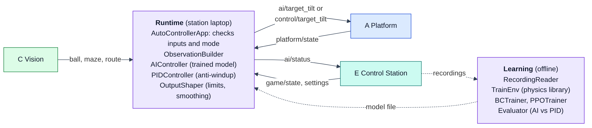

Figure 16 – D Auto Controller: parts and connections

#### D.4 Hardware

No hardware of its own, so no parts: 0 TL, 0 g. The controllers run on the station laptop. Learning runs offline on a team laptop, never during a game. Python 3.11; package versions are pinned in ai/requirements.txt.

#### D.5 Software design

The code lives in the ai/ folder of the repository. The AI learns in two steps; each step gives a working model, and a later step can fall back to the earlier one.

| Step | What | Data | When |
| --- | --- | --- | --- |
| 1 | Imitation (behaviour cloning): learn the tilt that was applied in a situation | Demonstrations of the PID Controller in the training environment (label: the PID command); after integration also recorded glove games (label: applied tilt from platform/state) | Before Dec 4; again after integration |
| 2 | Reinforcement learning (PPO), starting from the step 1 weights | Training environment with random physics and random mazes | Before Dec 4 |

After integration the step 2 model drives the real platform; recorded player games are added to step 1 when enough are available.

Observation, action and reward. One implementation in ai/common/, used in training and in the AI Controller, so the model sees the same numbers in both.

- Observation (board frame, D4 units): ball velocity, measured tilt, the previous command, and the next 3 route points relative to the ball. Because positions are relative to the ball, the network does not need to know where in the maze it is, so it also works on a changed maze.

- **Action:** target_tilt_x_deg, target_tilt_y_deg. The network outputs −1…1, scaled by max_tilt_deg; signs as in D4.

- **Network:** a small MLP, starting with the Stable-Baselines3 [7] default; its size is a training setting, saved with each model.

**Reward:** progress along the route, minus time, wall hits and large changes in tilt. Every evaluation uses fixed maze/seed pairs, the 120 s time limit and the same limits for AI and PID.

| Component | Responsibility | Interface |
| --- | --- | --- |
| AutoControllerApp | Validate current inputs, select AI or PID and publish commands | on_ball; on_route; on_game_state; tick |
| AIController | Load a model and compute a normalized action | load(model_version); act(observation) |
| PIDController | Compute position-error PID with velocity damping and anti-windup | compute(ball, target, dt_s); reset() |
| OutputShaper | Apply output bounds and optional smoothing | shape(action, limits); reset() |
| ObservationBuilder | Builds the same observation in training and at runtime | build(ball, tilt, previous_action, targets) |
| TrainEnv | Training environment built with a physics library (IF-08) | reset(seed, options); step(action) |
| RecordingReader | Turns recordings into training rows, using only earlier data of the same maze_id | load; training_rows |
| BCTrainer and PPOTrainer | Imitation and reinforcement learning | fit; train; save |
| Evaluator | Compare AI/PID on fixed scenarios | run(controller, scenarios); report |

PID Controller, per axis: e = first route point (target_points_mm[0]) − ball position; dt = difference of the timestamp_s of consecutive vision/ball messages; output = Kp·e + Ki·∫e·dt − Kd·ball velocity, clamped to max_tilt_deg. The integral term Ki·∫e·dt is limited to ±pid_integral_limit_deg and is not increased while the output is saturated (anti-windup). Gains are control variables, tuned in tests.

Both controllers return target_tilt_x_deg and target_tilt_y_deg: AIController.act(observation) and PIDController.compute(ball, target, dt_s).

**AI Controller, step by step**

- **On start:** load the newest model (or the one set in model_version), publish ai/variables_spec, subscribe to the topics in D.6; ai/status = idle.

- **On a new maze_id:** drop the old route and reset the PID integral. A route is used only when its maze_id matches vision/maze and its ball_seq matches the ball sample being answered. Without a valid route: ai/status = no_path and no output.

- For each ball sample, the controller answers once both the vision/ball message and the plan/route with the same ball_seq have arrived. If the state is playing, the mode is ai or simple, game and platform state are fresh, there is no fault and the route is valid, run the selected controller and publish to its topic. Otherwise publish nothing; without platform/variables_spec (max_tilt_deg) there is no output either (ai/status = stale_platform). The bridge is still the final gate.

- Every 0.1 s: publish ai/status.

**Learning, step by step**

RecordingReader turns recordings (PID demonstrations from the training environment; glove games after integration) into training rows; BCTrainer trains the step 1 model.

PPOTrainer trains in TrainEnv (several copies in parallel) from the step 1 weights; the result is the step 2 model.

Evaluator runs the AI and the PID Controller on the same mazes, seeds, limits and time limit in TrainEnv and reports success, time, wall hits and tilt smoothness.

A model is a file in ai/models/ named by model_version, <method>-<YYYYMMDD>-<n> (e.g. ppo-20261201-2), with a small JSON beside it (observation scales, training data, evaluation results). Model files must be small enough for the repo.

#### D.6 Inputs and outputs

| Direction | Message or topic | From / to | Rate | Interface |
| --- | --- | --- | --- | --- |
| In | vision/ball, vision/maze, plan/distance_map, plan/route | from C | every frame | IF-04 |
| In | platform/state, platform/variables_spec | from A | 50 Hz, on change | IF-02, IF-07 |
| In | game/state | from E | 10 Hz + changes | IF-05 |
| In | cs/variables/ai, cs/variables/pid | from E | on action | IF-07 |
| Out | ai/target_tilt (AI mode) or control/target_tilt (PID mode) | to A, E | each ball sample | IF-06 |
| Out | ai/status | to E | 10 Hz | IF-06 |
| Out | ai/variables_spec, pid/variables_spec | to E | on change | IF-07 |
| In (offline) | Recording files | from E | – | IF-09 |
| Inside D | TrainEnv reset/step; model files | Learning → AI Controller | – | IF-08 |

D owns IF-06 and IF-08. Learning runs offline and is not on the bus.

#### D.7 Control variables

Runtime AI settings use ai/variables_spec. PID settings use pid/variables_spec. The Control Station sends changes to the matching configuration key.

| Setting | Live? | Use |
| --- | --- | --- |
| model_version | no (next game) | Select trained model between games |
| action_smoothing_pct | yes | AI output smoothing |
| tilt_scale_pct | yes | AI output scale |
| pid_kp_deg_per_mm | yes | Proportional gain (deg/mm) |
| pid_ki_deg_per_mm_per_s | yes | Integral gain (deg/(mm·s)) |
| pid_kd_deg_per_mm_s | yes | Velocity damping gain (deg per mm/s) |
| pid_integral_limit_deg | yes | Largest tilt the integral term may add (±deg); tuned and saved with configuration |

Training settings are saved with each model. PID gains and integral limits are configurable through pid/variables_spec. Reset the integral on a new game, pause, mode change, new maze_id, fault or invalid input (the one reset list; D.5 and D.8 follow it). Anti-windup: the integral is not increased while the output is saturated. action_smoothing_pct and tilt_scale_pct apply to the AI only.

#### D.8 Errors and safety

| Condition | Response |
| --- | --- |
| Ball, platform or route missing/stale | Stop target output and reset the PID integral |
| Maze identity mismatch or no path | Report no_path; wait for matching Vision data |
| GameManager heartbeat missing | Stop output after 300 ms; status = stale_game |
| E-stop or platform fault | Stop output immediately; status = e_stop or fault |
| Model missing or non-finite action | Report failure; publish no invalid command |
| Replay session | Replay messages carry writer = replay; the controllers, GameManager and the bridge ignore them, and the controllers publish nothing |
| Controller crash | A's command timeout returns the platform to level |

A owns final actuator limits and safety. Auto Controller can fail by stopping or producing a poor bounded command, so its target output must never bypass the platform bridge and ESP32 checks.

#### D.9 Tests and Dec 4 demo

| Test | Requirement ID | Method | Pass if (target) |
| --- | --- | --- | --- |
| D-T1 AI in training environment | D-R1 | 100 runs on the demo maze, fixed seeds | ≥ 95 reach the exit within 120 s |
| D-T2 AI vs PID | D-R2 | Same 20 maze/seed cases | AI success rate ≥ PID success rate and AI median time < PID median time on the same 20 cases (both reported) |
| D-T3 Decision time | D-R3 | Time from the later of ball and route to publish, 10 000 samples | 99th percentile < 5 ms |
| D-T4 Only valid commands | D-R4 | Fixture sequences for every state, both modes, stale and missing inputs, wrong maze_id, no_path, fault | Commands only when all conditions hold; otherwise none |
| D-T5 PID output | D-R5 | Reference sequences with saturation, stop and restart | Matches the expected outputs; no windup |
| D-T6 Training rows | D-R6 | Recording with a maze change | Rows as expected; none mixes the two mazes |
| D-T7 Signs | D-R7 | Positive target tilt on each axis in TrainEnv | Ball moves towards the positive axis |

Demo on Dec 4 (3–5 min), with no other module running. A fixture script plays ball, route, platform and game state sequences from fixtures/ on a local broker; mosquitto_sub shows the answers.

1. AI mode: the saved model answers each ball sample with a target tilt within the limits.
2. PID mode: the same sequence with the PID Controller.
3. Wrong conditions: paused state, wrong mode, stale data, a different maze_id and no_path – no command is sent.
4. Instructor's input: the instructor can edit a sequence file (ball position, route, state) and run it again.
5. Training environment: run_test.py runs D-T1, D-T2 and D-T7 (the AI and the PID Controller on the demo maze), D-T6 builds the rows of a recording with a maze change, and the learning curves are shown.

#### D.10 Risks and fallback

| Risk | Impact | Fallback |
| --- | --- | --- |
| Training environment differs from the real platform | High | Randomise delay, noise and friction; compare with real recordings |
| Chosen physics library does not fit | Medium | TrainEnv hides it behind reset/step (IF-08), so another library can be used |
| AI misses the success target | High | Keep the best earlier model and report the measured results |
| PID oscillation or windup | High | Tune gains and integral bounds in local tests; reduce limits |
| Too few player recordings | Medium | Train step 1 on PID demonstrations; add player games when available |
| Shared laptop overload | Medium | Keep training offline; measure runtime load |

### E – Control Station

| Property | Design |
| --- | --- |
| Runs on | Station laptop, UI plus background services |
| Components | GameManager, UI, 3D Twin, Recorder and the replay controls |
| Languages | TypeScript: desktop app, 3D Twin (Three.js [8]), GameManager and Recorder (Node.js background processes) |
| Interfaces | IF-05 · IF-07 · IF-09 |

#### E.1 Purpose and scope

E runs the game and is the operator's window into the system. GameManager decides the game state, the mode, the progress, the finish and the warnings. The desktop app shows live plots, the camera image, the 2D maze, the 3D Twin and the control variables of every module, and sends the operator's commands. Recorder writes every game to a file. The app's replay controls play a recorded game in the same views through the shared replay tool. Because GameManager keeps running, game/state is not replayed on the bus; during replay the app shows the state, time, progress and result of the recording from ReplayController's file reader. GameManager and Recorder keep running when the app is closed. E never drives the motors; physical safety stays in A.

#### E.2 Requirements

| ID | Requirement | Target | How we check it |
| --- | --- | --- | --- |
| E-R1 | Show live 2D plots | 20 Hz, last 30 s visible | Replay a recorded game |
| E-R2 | Send commands valid for the current state | Sent within 100 ms; E-stop always enabled while the bus is connected (without the bus the physical button is the E-stop); an unconfirmed E-stop is warned after 1 s | Test script and mosquitto_sub |
| E-R3 | Build controls from variables_spec | Number, bool and choice variables with no module-specific code | Test spec for a made-up module |
| E-R4 | Topic health | A topic is shown as offline within 1 s after its max delay has passed | Stop each publisher in turn and time the warning |
| E-R5 | Recorder | One file per game; keeps recording if the app closes; replayed messages are not recorded | Close the app mid-game, then check the file |
| E-R6 | Camera feed and 3D Twin | Camera at 5–10 Hz; 3D Twin at 60 FPS, ≤ 20 ms from message to screen | Test JPEGs at 10 Hz; FPS and delay measured in the app |
| E-R7 | Correct game states | Every command in every state gives the transition of section 5, including pause, rescan and resume | Fixture with all command/state pairs |
| E-R8 | Correct finish | No finish before exit_hold_frames frames on the exit; no false finish in 20 fixture games | Fixture games |
| E-R9 | GameManager heartbeat | game/state at 10 Hz, no gap above 200 ms in 10 minutes | Logged timestamps |
| E-R10 | Warnings | not_moving and away_from_exit within 0.5 s of their thresholds | Fixture games |
| E-R11 | Safe replay | Nothing built from replayed messages reaches the platform or GameManager; the right maze is shown at each moment | Replay of a game with a maze change while the platform bridge runs |
| E-R12 | Same app on Windows and Linux | The same screens, controls and behaviour on both | E-T1…E-T15 run on both |

#### E.3 Module diagram

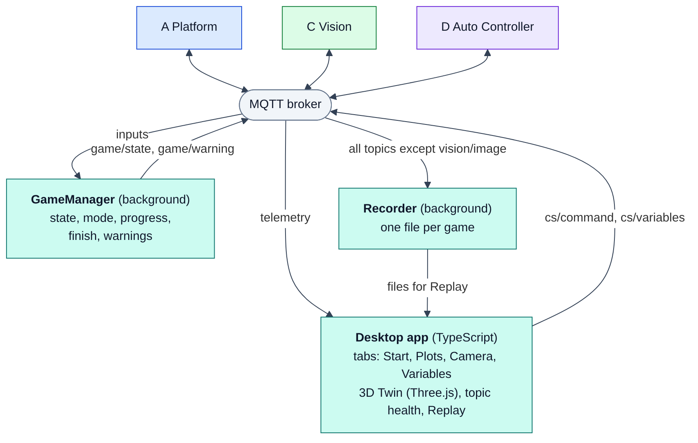

Figure 17 – E Control Station: parts and connections. GameManager inputs: ball, maze, route, edit state, platform and glove state, commands (E.6).

#### E.4 Hardware

No hardware of its own, so no parts, price or weight. It runs on the station laptop under Windows or Linux and has no special CPU or GPU needs. The laptop’s CPU is shared with Vision, AI and the broker, so we measure the load in tests. Recordings need free disk space.

#### E.5 Software design

| Class | Responsibility (one sentence) | Main public methods |
| --- | --- | --- |
| BusClient | Connects to the broker, keeps the latest message per topic, and handles all reads and writes for the app. | connect(url: string) -> void publish(topic: string, data: object) -> void subscribe(topic: string, callback: function) -> void unsubscribe(topic: string, callback: function) -> void get_latest(topic: string) -> object \| null |
| TopBar | Shows state, mode, time and banners on every tab (including a "Maze change" banner with the edit_state reason while the game is paused for a maze edit), and sends the E-stop. | on_game_state(msg: object) -> void on_ball(msg: object) -> void set_banner(kind: string, is_on: boolean) -> void send_e_stop() -> void |
| Tab (base class) | Shows or hides a tab when it opens or closes. | on_open() -> void on_close() -> void |
| StartTab | Sends game and replay commands, has Pause, Read maze and Resume buttons (Resume greyed out until there is a valid route for the new maze_id, section 5.5), greys out buttons not allowed in the current state, and shows the log. | send_command(cmd: string, args?: object) -> void start_replay(file: string, speed: number) -> void update_buttons(state: string \| null) -> void add_log(topic: string, msg: object) -> void |
| StatusPanel | Shows Vision, glove and AI status, and vision/edit_state with its reason, on the Start tab. | on_status(topic: string, msg: object) -> void set_missing(topic: string) -> void |
| MazeView | Draws the maze, the path to the exit and the ball on the Start tab. | on_maze(msg: object) -> void on_distance_map(msg: object) -> void on_ball(msg: object) -> void draw() -> void |
| VariablesTab | Builds controls from each module’s variables_spec and sends changes. | render(key: string, spec: object) -> void apply(key: string, name: string, value: number \| boolean \| string) -> void |
| PlotsTab | Manages the charts and passes each message to the right one. | add_field(topic: string, field: string) -> void remove_field(topic: string, field: string) -> void on_message(topic: string, msg: object, t_recv_s: number) -> void draw() -> void |
| Plot | Stores the time and value data for one chart, drops anything older than the plot window, and draws it with uPlot. | add_field(field: string) -> void remove_field(field: string) -> void add_message(msg: object, t_recv_s: number) -> void draw() -> void |
| TwinTab | Hosts the 3D Twin owned by E. | on_open() -> void on_close() -> void |
| CameraTab | Shows the camera feed, subscribing only while the tab is open. | on_image(jpeg: Uint8Array) -> void |
| TopicHealthMonitor | Tracks topic age and programs online, warns about two writers, and triggers missing-data warnings. | on_message(topic: string, seq: number, t_recv_s: number) -> void on_online(program: string, is_online: boolean) -> void check_topics(now_s: number) -> void |
| Recorder | Writes one file per game, re-subscribing at the start of each so it includes the retained maze data, and ignores every message whose writer is replay. | on_message(topic: string, msg: object, t_recv_s: number) -> void open_file(game_id: string) -> void close_file() -> void |

Background processes and the 3D Twin:

| Class | Responsibility (one sentence) | Main public methods |
| --- | --- | --- |
| GameManager | Decides state, mode, progress, finish and warnings and publishes game/state and game/warning. | on_command(msg: object) -> void; on_ball(msg: object) -> void; on_maze(msg: object) -> void; on_route(msg: object) -> void; on_edit_state(msg: object) -> void; on_platform_state(msg: object) -> void; on_glove_state(msg: object) -> void; tick(now_s: number) -> void |
| ThreeTwinViewport | Draws the maze, the ball and the plate tilt in 3D from live or replayed messages. | set_maze(msg) -> void; update(msg) -> void; set_stale(is_stale: boolean) -> void |
| ReplayController | Gives the app its replay controls and calls the shared replay tool (shared/tools/replay) in replay mode; reads the game/state lines of the recording file and gives the app the state, time, progress and result in step with the replay tool. | open(file: string) -> void; play(speed: number) -> void; pause() -> void; stop() -> void |

StartTab, VariablesTab, PlotsTab, TwinTab and CameraTab extend Tab.

- **On start:** main.ts creates the classes, connects BusClient and sets up the subscriptions.

- **On each message:** BusClient saves the latest message and calls the subscribed classes.

- **On each timer tick:** PlotsTab and MazeView redraw while the Start or Plots tab is open, and TopicHealthMonitor checks topic ages and turns warnings on or off.

- **On a user action:** the tab publishes cs/command or cs/variables/<key>, and the app shows the result only when game/state or variables_spec reports it.

Recorder runs independently of the app, opens a file for each new game_id and records the retained maze and planning data first. During a maze change it records every new maze_id and route. Replay messages carry writer = replay: the Recorder, GameManager, the controllers and the platform bridge ignore them, so nothing built from them reaches the ESP32 or the glove.

#### E.6 Inputs and outputs

| Direction | Message or topic | From / to | Rate | Interface |
| --- | --- | --- | --- | --- |
| In | platform/state, glove/state | from A | 50 Hz | IF-02 |
| In | vision/ball, vision/maze, plan/distance_map, plan/route, vision/edit_state, vision/status, vision/event, vision/image | from C | every frame … 1 Hz | IF-04 |
| In | ai/target_tilt, control/target_tilt, ai/status | from D | each ball sample, 10 Hz | IF-06 |
| In | \*/variables_spec, sys/online/\* | from every module | on change | IF-07, IF-03 |
| Out | game/state, game/warning (GameManager) | to A, C, D | 10 Hz + changes, on event | IF-05 |
| Out | cs/command, cs/variables/<key> (app) | to A, C, GameManager and the replay tool | on action | IF-07 |
| Out | game/variables_spec (GameManager), cs/variables_spec (app settings) | to the app | on change | IF-07 |
| Out | Recording files (Recorder) | to D Learning, Replay | one file per game | IF-09 |

E owns IF-05, IF-07 and IF-09.

#### E.7 Control variables

| Name (unit in the name) | Live? | Meaning |
| --- | --- | --- |
| plot_window_s | yes | How much time each plot shows and keeps |
| plot_rate_hz | yes | How often the plots redraw |
| maze_view_rate_hz | yes | How often the 2D maze view redraws |
| health_check_rate_hz | yes | How often topic ages are checked |
| log_max_lines | yes | How many lines the log keeps |
| recording_folder | no | Where the Recorder saves its files |
| recording_tail_s | no | How long recording continues after a game ends (2 s in IF-09) |
| not_moving_time_s | yes | Time the ball must stay still before the not_moving warning; start value 3 s |
| not_moving_radius_mm | yes | Movement inside this radius counts as still; start value 5 mm |
| away_hold_time_s | yes | Time the distance must stay larger before away_from_exit; start value 1.5 s |
| warning_cooldown_s | yes | Minimum time between repeated warnings; start value 3 s |
| ball_lost_pause_s | yes | Time without the ball before paused; start value 2 s |
| glove_lost_pause_s | yes | Time without the glove before paused (glove mode); start value 1 s |
| exit_hold_frames | no | Consecutive is_on_exit frames that finish the game; start value 15 (about 0.5 s at 30 fps) |
| time_limit_s | no | Optional game time limit; off by default, used in comparison runs |

#### E.8 Errors and safety

| What can go wrong | How we detect it | What the module does |
| --- | --- | --- |
| E-stop command isn’t confirmed | platform/state does not confirm is_e_stop within 1 s | Shows “E-stop not confirmed: use the E-stop button” |
| Broker connection lost | mqtt.js connection event | Shows “Bus not connected”, disables the buttons (the physical E-stop button still works) and keeps trying to reconnect |
| GameManager stops | No game/state for 300 ms | Shows “No GameManager” and disables game buttons; E-stop stays enabled |
| Platform bridge stops | No platform/state for 200 ms | Shows “Platform not connected” |
| Vision stops | No vision/ball for 200 ms, or no vision/status for 3 s | Freezes the plots, turns the health panel red, and shows “no status” on the Vision panel |
| Ball lost during a game | is_visible is false in vision/ball | Shows “ball not visible”; GameManager pauses the game after 2 s |
| App closes or crashes | sys/online/cs_app is false | Recorder keeps recording; the E-stop button still cuts the motors |
| Recorder stops or the disk is full | File write error, or sys/online/recorder is false | On a write error, the Recorder closes the file and exits; the health panel shows it offline |
| Replay mixes with live data | Replay is started while the live system runs | Topics with a running writer are skipped; the Recorder, GameManager, the controllers and the bridge ignore replay messages; the app shows a “Replay” banner |
| Bad variables_spec | Missing fields or wrong types | Skips that variable and writes it to the log |
| Two programs write the same topic | The writer field changes on that topic | Shows a two-writer warning on the health panel |

The Control Station app can request a software E-stop. A enforces the physical switch and the command timeout independently. GameManager and Recorder are separate background components owned by E. UI closure does not end either service; GameManager failure closes A’s gate through heartbeat loss.

#### E.9 Tests and Dec 4 demo

| Test | Requirement ID | Method | Pass if (target) |
| --- | --- | --- | --- |
| E-T1 Plot rate | E-R1 | Replay a sample game and log draw times | Plots update at 20 Hz, with the last 30 s visible |
| E-T2 Button states | E-R2 | E-owned fixture sends commands and telemetry to GameManager for every state | Buttons match the IF-07 table; E-stop is always enabled |
| E-T3 Commands | E-R2 | Press each button, and compare click times with mosquitto_sub output | Correct command on the bus within 100 ms |
| E-T4 E-stop not confirmed | E-R2 | Press E-stop while the fixture publisher does not respond | Warning appears after 1 s |
| E-T5 Variables | E-R3 | Publish a spec for a made-up module with number, bool and choice variables | Controls appear with no code change; the panel shows the value the module reports back |
| E-T6 Missing data | E-R4 | Stop each topic in turn | Warning appears within 1 s after that topic’s max delay |
| E-T7 Recording | E-R5 | Run two test games with new game_ids; close the app during the second | Two files, each starting with the maze data; the second keeps growing |
| E-T8 No replay in the recording | E-R5 | Replay a game during a live test game | No replay message in the file; live messages are still recorded |
| E-T9 Camera and 3D | E-R6 | Publish test JPEGs at 10 Hz, then open the 3D tab during a replay | Camera keeps up; the twin shows the replayed game |
| E-T10 Game states | E-R7 | Fixture sends every command in every state, including pause, rescan and resume | Transitions match section 5 |
| E-T11 Finish | E-R8 | 20 fixture games with the ball near and on the exit | No early or false finish |
| E-T12 Heartbeat | E-R9 | Log game/state for 10 minutes | 10 Hz, no gap above 200 ms |
| E-T13 Warnings | E-R10 | Fixture games that cross the thresholds | Warnings within 0.5 s |
| E-T14 3D Twin | E-R6 | Fixture telemetry at 50 Hz | 60 FPS, ≤ 20 ms from message to screen |
| E-T15 Safe replay | E-R11 | Replay a game with a maze change while the platform bridge and GameManager run | No TargetTilt, HostState or Warning from replayed messages; GameManager's state and the live recording do not change |
| E-T16 Windows and Linux | E-R12 | Build the app on both systems and run the fixture tests | All tests pass on both; same tabs and controls |

Demo on Dec 4 (3–5 min), with no other module running. A fixture publisher script in fixtures/ publishes telemetry and answers commands on a local broker; the instructor can edit its input files (ball path, maze, platform state) and run it again.

- **Missing data:** open the app with nothing else running. Banners are on and the health panel is red. Start the fixture publisher, and they clear.

- **Commands:** press Start, Pause and E-stop. mosquitto_sub shows each command, the state changes, and the buttons grey out correctly.

- **Maze change:** the fixture publisher sends edit_state = hand_present. The game pauses and the "Maze change" banner shows the reason. Then it sends clear and a new route: Resume is enabled, press Resume, the game is playing again.

- **Warnings:** the ball in the fixture stops; the not_moving warning appears.

- **Variables:** move a slider past its limit. The module clamps the value, and the panel shows what it reports back.

- **Recorder:** run a test game and close the app partway through. The file keeps growing. Reopen the app and show the file, with the maze data first.

- **Replay:** stop the fixture publisher and start the replay. Show the plots, 2D maze, log, 3D Twin and “Replay” banner, and that the Recorder writes nothing.

#### E.10 Risks and fallback

| Risk | Likelihood | Impact | Fallback |
| --- | --- | --- | --- |
| Other modules are not ready for Dec 4 | High | Low | Sample replay and our fixture publisher stand in for them |
| Playback tool or sample recordings are late | Medium | High | The fixture publisher publishes sample messages from the agreed message structure |
| 3D Twin is late or can’t stop drawing while hidden | Medium | Low | App works without the 3D tab; skip that demo step, or keep it hidden and accept the CPU use |
| Live plots and camera feed slow the app on the shared laptop | Medium | Medium | Lower plot_rate_hz, limit the number of charts, and stop drawing on hidden tabs |
| Agreed message formats change late | Medium | Medium | Change only the class that reads them; hide the 2D maze if needed, since the Camera and 3D tabs also show the maze |
| Replay mixes with live data and spoils a recording | Medium | High | Replay skips topics whose real writer runs; Recorder ignores writer = replay |
| Recorder misses messages under load or the disk fills up | Low | High | Missing seq numbers show the gaps; change recording_folder or delete old files; Recorder exits on a write error and the health panel shows it offline |
| A wrong topic name fails silently | Low | Medium | Use names only from shared/topics.ts; the topic-health panel shows topics that aren’t arriving |

## Appendix – Interface specification

This appendix gives the full specification of every interface. Common to every bus topic (IF-03): each message is a JSON object with the envelope timestamp_s, seq, version and writer; the field tables list only the payload. Units are in the field names (section 4).

**How to read it:** one block per topic or message, with a line giving its writer, rate and whether it is retained; the field table; the readers with their maximum delay and what they do if it is missing; and its rules.

### Words used

- **Cell** – {row, col}; row 0 / col 0 at the origin corner of the maze file; rows grow towards +y, columns towards +x.

- **max_tilt_deg** – the platform's angle limit, published in platform/variables_spec (A.7).

- **Tilt axes (D4)** – tilt_x_deg = positive rotation about +y; tilt_y_deg = negative rotation about +x. Then tilt_x_deg > 0 rolls the ball to +x and tilt_y_deg > 0 to +y.

- **Modes** – glove, ai, simple (PID controller). States – setup, ready, playing, paused, finished, e_stop (D5).

- **Stand-in** – a module-owned test publisher or fixture reader running on a local test broker. Other production modules remain stopped during a standalone demo.

- **seq (sequence number)** – a counter in the envelope of every message: +1 per message, per topic and per program, starting at 0 when the program starts (IF-03). A missing number shows a lost message; a repeated number shows a duplicate. ball_seq in ai/target_tilt and control/target_tilt is the seq of the vision/ball message a command answers.

- **QoS** – MQTT delivery level of a topic. 0 = sent once and may be lost; used for fast streams where the next message replaces a lost one (vision/ball, platform/state). 1 = delivered at least once and may arrive twice; used for commands, events and retained topics, so readers drop a repeated seq. Details in IF-03.

- **Ret. (retained)** – the broker keeps the last message of the topic and gives it at once to every new subscriber, e.g. a program that restarts gets the maze and the game state immediately.

### IF-01 – Glove ESP32 ↔ Platform ESP32

Not on the bus; the glove and the platform use ESP-NOW [9]. The platform bridge later publishes the glove's data as glove/state (IF-02). The glove never talks to the laptop. Glove board: ESP32-C3.

#### Glove → Platform: GloveData

**Rate:** 50 Hz   ·   **Max delay:** 30 ms (lost after 300 ms)

| Field | Type | Unit | Values / range | Meaning |
| --- | --- | --- | --- | --- |
| msg_type | uint8 | – | 1 = GloveData | Packet type |
| seq | uint16 | – | 0…65535, wraps | +1 per packet; the platform counts lost packets |
| hand_tilt_x_deg | float | deg | ±90 | Filtered hand roll after calibration. > 0 → the ball should roll to +x |
| hand_tilt_y_deg | float | deg | ±90 | Filtered hand pitch after calibration. > 0 → the ball should roll to +y |
| ax_m_s2, ay_m_s2, az_m_s2 | float | m/s² | ±2 g (±19.6) | Raw accelerometer |
| gx_deg_s, gy_deg_s, gz_deg_s | float | deg/s | ±250 | Raw gyroscope |
| is_calibrated | bool | – |  | A calibration has been done since power-on |

**Rules**

- The glove sends only roll and pitch; no yaw. The mapping from hand tilt to platform tilt (gain, dead zone, limits) runs on the platform ESP32, not in the glove.

#### Glove → Platform: GloveStatus

**Rate:** 1 Hz and on change

| Field | Type | Unit | Values / range | Meaning |
| --- | --- | --- | --- | --- |
| msg_type | uint8 | – | 2 = GloveStatus | Packet type |
| battery_pct | uint8 | % | 0–100 | Battery level |
| firmware_version | uint16 | – |  | Glove firmware version |

**Rules**

- rssi_dbm is measured by the platform when it receives a packet; the glove does not send it.

#### Platform → Glove: GameInfo (heartbeat)

**Rate:** 5 Hz and on change   ·   **Max delay:** 1 s

| Field | Type | Unit | Values / range | Meaning |
| --- | --- | --- | --- | --- |
| msg_type | uint8 | – | 10 = GameInfo | Packet type |
| mode | uint8 | – | glove / ai / simple | Current mode (from game/state, or the ESP32's own mode without the laptop) |
| state | uint8 | – | D5 states + no_laptop | Game state; no_laptop when the laptop is lost |
| is_vibration_enabled | bool | – |  | From cs/variables/glove |
| vibration_intensity_pct | uint8 | % | 0–100 | From cs/variables/glove |
| calibrate_request | uint8 | – | counter | +1 on a long press (~3 s) of the platform button, or on calibrate_glove from the Control Station → the glove calibrates (hand flat) |

**Rules**

- The glove calibrates by itself when the state becomes ready in glove mode, and whenever calibrate_request changes. Without the laptop only the long press is possible.

- **Calibration:** the player holds the hand flat; the glove waits until the hand is still, takes that pose as 0° and sets is_calibrated = true. The Control Station shows "hold your hand flat" in ready (glove mode).

- No GameInfo for 1 s → the glove shows "disconnected" (on-board LED of the ESP32-C3 + one long vibration) and keeps sending GloveData.

#### Platform → Glove: Haptic

**Rate:** on event   ·   **Max delay:** 100 ms

| Field | Type | Unit | Values / range | Meaning |
| --- | --- | --- | --- | --- |
| msg_type | uint8 | – | 11 = Haptic | Packet type |
| pattern_id | uint8 | – | see the list below | Which pattern to play |
| intensity_pct | uint8 | % | 0–100 | Strength, already scaled by vibration_intensity_pct |
| duration_ms | uint16 | ms | 0–2000 | Total length |

**Rules**

- The glove does not decide warnings; it plays the pattern it receives.

- Vibration patterns – the platform ESP32 picks the pattern and sends its number; the glove plays it. Four patterns plus "disconnected"; their shapes are tuned in tests.

| pattern_id | Meaning | Sent when | Shape |
| --- | --- | --- | --- |
| 1 | not_moving | game/warning kind = not_moving, glove mode, playing | two short pulses |
| 2 | away_from_exit | game/warning kind = away_from_exit, glove mode, playing | one medium pulse |
| 3 | mode_changed | the mode changes | three short pulses |
| 4 | calibrated | calibration finished | one short pulse |
| – | disconnected | played by the glove itself when GameInfo stops | one long pulse |

**Notes**

- **Number format:** float.

- **Pairing:** fixed MAC addresses in a shared config header (shared/); the platform ignores packets from any other address.

- **Glove lost:** the platform holds the last tilt, then levels after 300 ms (A.8, IF-02 is_glove_connected).

- Pattern IDs are fixed in the table above; the shape of each pattern (pulse lengths) is tuned in tests by Glove and Platform.

### IF-02 – Platform bridge ↔ Platform ESP32

The bridge is a Python program on the laptop (Platform module). It is the only program on the serial port. It writes platform/\* and glove/\* on the bus and forwards commands to the ESP32.

#### Serial link

921600 baud, 8N1. Frame format: COBS encoding + CRC-16/CCITT-FALSE. Multi-byte fields use Little Endian byte order. Frame definitions are shared between ESP32 (C/C++) and Platform Bridge (Python) in shared/.

| Direction | Message | Rate | Content |
| --- | --- | --- | --- |
| ESP32 → bridge | PlatformState | 50 Hz | fields of platform/state |
| ESP32 → bridge | GloveData, GloveStatus | 50 Hz / 1 Hz | passed on from IF-01, plus rssi_dbm |
| bridge → ESP32 | HostState | every game/state (10 Hz) | state, mode – also the laptop heartbeat (not the ESP-NOW GameInfo of IF-01) |
| bridge → ESP32 | TargetTilt | every ai/target_tilt (or control/target_tilt) that passes the gate | target_tilt_x_deg, target_tilt_y_deg |
| bridge → ESP32 | Warning | on game/warning, glove mode only | kind, intensity_pct (the ESP32 picks the pattern – IF-01) |
| bridge → ESP32 | Settings | on cs/variables/platform and cs/variables/glove | the platform and glove variables |
| bridge → ESP32 | Command | on cs/command | e_stop, clear_e_stop, calibrate_glove |

#### platform/state

**Writer:** platform bridge   ·   **Rate:** 50 Hz   ·   **Retained:** no

| Field | Type | Unit | Values / range | Meaning |
| --- | --- | --- | --- | --- |
| tilt_x_deg, tilt_y_deg | float | deg | ±max_tilt_deg | Measured plate tilt (IMU on the plate) |
| applied_tilt_x_deg, applied_tilt_y_deg | float | deg | ±max_tilt_deg | Target the ESP32 is applying now, after the angle and speed limits. (AI training label) |
| source | string | – | none / glove / ai / simple | Where the applied target comes from; none = holding level |
| mode | string | – | glove / ai / simple | Mode the ESP32 is in now |
| mode_button_presses | int | – | counter | +1 per short press. Long presses do not count. |
| is_e_stop | bool | – |  | true: the E-stop button is pressed (the ESP32 reads its second contact) or the e_stop command arrived; clear_e_stop is refused while the button is still pressed; stays true until clear_e_stop (without the laptop: until the button is released). If the ESP32 is unreachable, platform/state stops and the Control Station shows the lost connection. |
| is_laptop_connected | bool | – |  | ESP32 receives HostState |
| is_glove_connected | bool | – |  | GloveData arrived in the last 300 ms |
| fault | string | – | none / motor / imu / power / serial / watchdog / calibration | Highest active fault |

| Reader | Max delay | If it is missing |
| --- | --- | --- |
| Control Station game management | 200 ms | Ignore the button; playing → paused |
| Auto Controller runtime | 100 ms | Stop output on stale data, E-stop or fault |
| Control Station | 200 ms | "Platform not connected" banner |
| 3D Twin | 200 ms | Freeze the view, show a stale-data warning |

#### glove/state

**Writer:** platform bridge (for the glove)   ·   **Rate:** 50 Hz   ·   **Retained:** no

| Field | Type | Unit | Values / range | Meaning |
| --- | --- | --- | --- | --- |
| hand_tilt_x_deg, hand_tilt_y_deg | float | deg | ±90 | From GloveData |
| ax_m_s2, ay_m_s2, az_m_s2 | float | m/s² |  | Raw accelerometer |
| gx_deg_s, gy_deg_s, gz_deg_s | float | deg/s |  | Raw gyroscope |
| battery_pct | int | % | 0–100 | Latest GloveStatus |
| rssi_dbm | int | dBm | −100…0 | Measured by the platform ESP32 |
| is_calibrated | bool | – |  | From GloveData |
| is_connected | bool | – |  | GloveData arrived in the last 300 ms |
| firmware_version | int | – |  | Latest GloveStatus |

| Reader | Max delay | If it is missing |
| --- | --- | --- |
| Control Station | 200 ms | Glove panel shows "not connected" |
| Recorder | – | Gaps visible in the file |

**Rules**

- Published in every mode, so player games can be studied later. The AI's training label is applied_tilt_* in platform/state, not the hand tilt.

#### platform/variables_spec and glove/variables_spec

**Writer:** platform bridge   ·   **Rate:** on start and on change   ·   **Retained:** yes

**Rules**

- **Format:** IF-07. The bridge publishes the glove's variables too, because the glove is not on the bus.

- platform: max_tilt_deg, max_tilt_speed_deg_s (physical limits, from Platform; the values are set once the platform is built and measured), glove_gain, glove_deadzone_deg (initial values set in tests), serial_port (choice: the ports the bridge finds, e.g. COM3; live – the bridge reopens the port).

- glove: is_vibration_enabled, vibration_intensity_pct, filter_strength (Glove).

#### The gate

- The bridge sends a TargetTilt from ai/target_tilt only if mode = ai, state = playing and the last game/state is less than 300 ms old (by its timestamp_s, IF-03). Same rule for control/target_tilt with mode = simple.

The bridge accepts only commands for the active game maze and current mode, never replay-origin commands.

- Gate closed → nothing is sent; the ESP32 command timeout levels the platform when no TargetTilt has arrived for 200 ms in AI or PID mode.

#### ESP32 behaviour

- **Glove mode with the laptop:** follows the hand only in playing; level in setup, ready, paused, finished, e_stop.

- Without the laptop the ESP32 follows the glove only after one short button press: at power-on, after the E-stop button is released, and after the laptop is lost while the game was not playing. Laptop lost (no HostState for 300 ms) while playing in glove mode: it keeps following the hand. In AI or PID mode it levels and stays level until one short press switches to glove mode. Further presses do nothing until the laptop is back. When the laptop is back, the laptop wins: the ESP32 follows the state and mode in HostState.

- **Power-on:** glove mode after one short press (see above).

- **Mode button:** short press = mode request (counted in mode_button_presses; with the laptop GameManager decides). Long press (~3 s) = glove calibration; ignored in playing. Mode LED shows the current mode. Stays on the platform, not on the glove.

- **E-stop:** a latching mushroom E-stop button (22 mm, 1NO + 1NC, turn to release, e.g. XB2 or LAY37-11ZS series). The NC contact cuts the servo power directly – no software. The NO contact goes to an ESP32 input; the ESP32 is powered before the button, so it sets is_e_stop = true and GameManager goes to e_stop. The e_stop command → level and locked. With the laptop, the ESP32 leaves the E-stop only on clear_e_stop and then levels before it follows targets again; without the laptop it leaves it when the button is released and stays level until one short press (see above). The ESP32 software watchdog stays.

- **Bridge:** reconnects to the serial port by itself after a USB unplug or laptop sleep. The port (e.g. COM3 on Windows, /dev/ttyUSB0 on Linux) starts from a config file and can be changed from a drop-down in the Control Station (serial_port).

**Notes**

- **Serial frame format:** COBS framing with a CRC-16 on every frame (IF-02 serial link; A.5 SerialHandler).

- fault values: none, motor, imu, power, serial, watchdog, calibration (none when there is no fault). watchdog = the ESP32 software watchdog fired (unexpected software lock-up or reset); it is not the 200 ms command timeout. A missing TargetTilt is not a fault: the ESP32 levels the platform and reports source = none.

### IF-03 – Bus basics

#### Broker

- Mosquitto on the station laptop, localhost only, no password. Port 1883 (TCP – every program except the app’s UI: the Python programs and the Node.js GameManager and Recorder) and port 9001 (WebSocket – the Control Station app’s UI). Settings in shared/bus/mosquitto.conf.

- Every developer runs the same broker on their own laptop for standalone work.

#### Envelope (every message)

| Field | Type | Unit | Values / range | Meaning |
| --- | --- | --- | --- | --- |
| timestamp_s | float | s | Unix time | Laptop clock when the message was published. The shared helper takes the wall clock once at start-up and adds the time.perf_counter() difference (time.time() is too coarse on Windows) |
| seq | int | – | 0, 1, 2 … | +1 per message, per topic, per program; restarts at 0 when the program starts |
| version | int | – | 1, 2 … | Message format version of that topic; +1 when a field changes meaning. Readers reject versions they do not support |
| writer | string | – | bridge, vision, auto_controller, game_manager, cs_app, recorder, replay | Program that published the message. Filled in by the shared helper; replay sets "replay" |

- **Payload:** one JSON object (UTF-8) with the envelope fields plus the topic's fields. Exceptions: vision/image (IF-04) and sys/online/<program> (a plain bool).

- ESP32 data has no laptop time; the bridge stamps it when it receives it.

- A reader judges the age of a message from timestamp_s (all programs use the laptop clock). Replay rewrites timestamp_s to the replay clock (IF-09), so the rule also holds in replay. Recordings are joined by the Recorder's t_recv_s (IF-09), not by timestamp_s.

#### Topic names

- Constants in shared/topics.py and shared/topics.ts; nobody types a topic string by hand.

Configuration keys are platform, glove, vision, ai, pid, game and cs. E owns game and cs, D owns ai and pid. Game settings and PID settings use separate configuration keys.

Runtime program identifiers are bridge, vision, auto_controller, game_manager, cs_app, recorder and replay. Learning has no runtime MQTT identity. sys/online/<program> is published by the shared helper.

#### Retained topics and delivery

|  | Topics |
| --- | --- |
| Retained | game/state, plan/distance_map, vision/maze, vision/status, vision/edit_state, cs/variables/\*, \*/variables_spec, sys/online/\* |
| QoS 1 (delivered at least once) | cs/command, vision/event, game/warning, all retained topics |
| QoS 0 (fast, may drop) | vision/ball, vision/image, plan/route, platform/state, glove/state, ai/target_tilt, control/target_tilt, ai/status |

QoS 1 can deliver a message twice, so commands and events must be safe to repeat: GameManager ignores start outside ready, a second e_stop changes nothing, and readers drop a repeat: same writer, seq and timestamp_s (seq alone restarts at 0 when a program restarts).

A retained message is delivered at once when a program subscribes, even if it is old. Before trusting a retained message, a reader checks its envelope timestamp_s (all programs run on the same laptop clock); an old edit_state = clear or an old route after a restart is treated as missing.

#### sys/online/<program>

**Writer:** the shared helper, for each program   ·   **Retained:** yes

| Field | Type | Unit | Values / range | Meaning |
| --- | --- | --- | --- | --- |
| (payload) | bool | – | true / false | true on connect. The broker publishes false if the program dies (MQTT Last Will). |

| Reader | Max delay | If it is missing |
| --- | --- | --- |
| Control Station | – | Topic-health panel shows the program as offline |

#### shared/

shared/ holds code and data that more than one module uses; it is a library in the repository, never a running module, so using it does not make one module depend on another running module.

| Item | Owner | Used by |
| --- | --- | --- |
| Topic names, message constants, bus helpers (envelope, sys/online) | Shared (integration) | all laptop programs |
| ESP-NOW packet headers (IF-01) | B | A, B |
| Serial packet headers (IF-02) | A | A (ESP32 and bridge) |
| Maze file format, consistency check, distance map and route function (shared/mazes/) | C | C at runtime, D in training |
| Playback tool (shared/tools/replay) | Shared (integration) | any module; E for its replay controls |
| Sample recordings (shared/samples/) | E | E, D |

- Every item has one owner who writes and maintains it. As with interfaces, nobody changes it alone: a change needs the agreement of the modules that use it.
- Each owner's tests cover the item (e.g. C-T7 for the route function), so a change that breaks another module shows up at once.
- Every module owns its own fixtures and test publishers.

Python 3.11 is used by every Python program. The Control Station app uses TypeScript; GameManager and Recorder run as separate background processes of E, written in TypeScript (Node.js). Learning pins its libraries in its own requirements file.

- **Missing values (D4):** a field that has no value right now is sent as null (e.g. cell while the ball is not visible, game_id before the first game) – never left out. Required fields are never null; each field table says which fields may be null.

**Station laptop:** a team member's laptop. Every laptop program – the platform bridge, Vision, the Auto Controller, GameManager, the Recorder, the Control Station app and the playback tool – runs on **Windows and Linux** (e.g. Ubuntu 24.04 LTS), and the Control Station looks and works the same on both. Therefore:

- Only cross-platform parts: Python 3.11, Electron, Mosquitto, OpenCV; no operating-system-specific libraries.
- Mosquitto runs as a Windows service or a Linux systemd service.
- Serial port (e.g. COM3 on Windows, /dev/ttyUSB0 or /dev/ttyACM0 on Linux) and camera index start from a config file, not the code, and can be changed from drop-downs in the Control Station (serial_port, camera_index – choice variables, IF-07).
- File paths are built with the language's path functions, never written with `\` or `/` by hand. On Linux the user is added to the dialout and video groups so the bridge can open the serial port and Vision the camera.
- USB power saving off so the serial link and the camera do not drop.

Every module supplies its own fixture generator or test publisher. Production programs that own the same topics are stopped. Replay never plays a topic whose real writer is running, and the platform bridge rejects commands written by replay, so recorded commands cannot reach the physical platform.

### IF-04 – Vision topics

IF-04 is owned by C Vision and covers vision/\*, plan/distance_map, plan/route and maze geometry. D reviews route consumption and E reviews game and replay consistency.

Only mm, mm/s and cells leave Vision; pixels stay inside. Positions are in the board frame (D4), from the 4 ArUco markers on the plate, so they are correct even when the plate is tilted.

#### Board frame, cells and walls

**Directions:** N = +y (far edge, away from the player), E = +x (right edge), S = −y (player side), W = −x.

Cell {0, 0} is the front-left cell (−x, −y corner as seen by the player). Rows grow towards +y (N), columns towards +x (E). Arrays are indexed walls[row][col].

**Cell centre:** x_mm = origin_x_mm + (col + 0.5) × cell_size_mm, y_mm = origin_y_mm + (row + 0.5) × cell_size_mm. Only the shared helper (shared/mazes/) computes it.

#### vision/ball

**Rate:** every frame (30–60 Hz)   ·   **Retained:** no

| Field | Type | Unit | Values / range | Meaning |
| --- | --- | --- | --- | --- |
| x_mm, y_mm | float | mm | ± half the plate size | Ball centre (filtered, parallax corrected). When lost: last known position |
| vx_mm_s, vy_mm_s | float | mm/s |  | Ball velocity (filtered). 0 while is_visible = false |
| is_visible | bool | – |  | false after lost_timeout_ms (200 ms) without a detection |
| is_predicted | bool | – |  | true while the filter bridges a short gap (ball hidden) |
| is_on_exit | bool | – |  | The measured ball centre is inside the exit marker in this frame (distance to exit_x_mm, exit_y_mm ≤ exit_radius_mm). false when is_predicted or not visible. Sent every frame; GameManager counts |
| frame_age_ms | float | ms | 0–100 | Time from the frame's arrival at the laptop to publish (target < 40 ms). Does not include the camera's own internal delay |
| meas_x_mm, meas_y_mm | Float or null | mm |  | Unfiltered measurement in this frame; null when the ball was not detected. For wall-hit tuning and training |

| Reader | Max delay | If it is missing |
| --- | --- | --- |
| Control Station game management | 200 ms | Keep the last value; pause progress and warnings |
| Auto Controller runtime | 100 ms | Stop output at once (A's command timeout levels the plate); ai/status = ball_lost |
| Control Station | 200 ms | Plots freeze; topic-health panel turns red |
| 3D Twin | 200 ms | Freeze the view |

**Rules**

- Not published until the markers have been seen once (is_calibrated in vision/status).

- Keeps publishing with is_visible = false when the ball is lost.

- fps_hz and is_calibrated are in vision/status, not here.

#### vision/maze

**Rate:** after each validated scan (automatic rescan or read_maze)   ·   **Retained:** yes

| Field | Type | Unit | Values / range | Meaning |
| --- | --- | --- | --- | --- |
| maze_id | string | – | from the maze file, or scan-<time> | Which maze |
| source | string | – | file / scan / file_checked | file_checked = file confirmed by the camera scan |
| cell_size_mm | float | mm |  | Cell edge length |
| rows, cols | int | – |  | Grid size |
| origin_x_mm, origin_y_mm | float | mm |  | Board-frame position of the outer corner of cell {0, 0} |
| walls | int[rows][cols] | – | bit flags N=1, E=2, S=4, W=8 | walls[row][col]: walls on the edges of each cell (N = +y side, E = +x side, S = −y side, W = −x side). Outer borders closed, neighbour flags must agree (helper in shared/mazes/). |
| wall_thickness_mm, wall_height_mm | float | mm |  | Physical wall size (Platform numbers). For the 3D Twin, wall-hit detection and the training environment |
| start_cell | cell or null | – |  | Start cell; null until known (see the rules). Never the same as exit_cell |
| exit_cell | cell | – |  | Cell that contains the centre of the exit marker ("exit", never "goal") |
| exit_x_mm, exit_y_mm | float | mm |  | Centre of the exit marker in the board frame |
| exit_radius_mm | float | mm |  | Radius of the exit marker |
| ball_diameter_mm | float | mm |  | Ball size used by Vision |

Readers are D Auto Controller and E GameManager / 3D Twin. A missing or invalid maze blocks automatic play. The Twin shows unavailable or stale data instead of substituting a different maze.

**Rules**

- **Maze file:** shared/mazes/<maze_id>.json has exactly these fields (without the envelope and source); start_cell may be left out. Vision owns the format and the consistency helper.

- A geometrically valid maze has consistent neighbour flags and closed outer borders. Reachability is a separate planning result. An unreachable exit is reported as no_path and blocks start or resume. A confirmed changed layout receives a new immutable maze_id, even when the physical board is the same.

- read_maze runs with the board level: Vision estimates the plate tilt from the ArUco markers and rejects the scan above 1°. A scan is published only when it passes validation and two scans in a row agree; if it differs from the matching file, it is published with maze_match = none and the differing walls are marked on vision/image. A failed rescan invalidates the pending route and keeps the game paused. The last valid map may remain visible with a stale indicator but cannot authorize resume.

- read_maze is accepted in setup, ready or paused. During play, hand_present or occluded pauses the game (section 5.5). When the playfield has been clear and still for edit_clear_time_s, Vision rescans by itself (state = rescanning). If the rescan fails or hand detection is off, the operator can send read_maze in paused. The game continues only after an explicit Resume. read_maze needs the exit marker fully visible; if the ball or a hand covers it, the scan is not published and edit_state reason = exit_hidden. The full maze change sequence is in section 5.5. calibrate_camera is accepted only in setup and ready.

- The start cell is established at the beginning of a game from the validated file or observed ball. After an in-game map edit, planning resumes from the current ball cell. The original game_id and elapsed active time are retained, while maze_id changes. Replan progress baselines and exit counters are reset.
- If start_cell is null (no start marker and none in the maze file), start is accepted with the ball visible in any cell; that cell becomes the start cell of the game.

#### vision/event

**Rate:** on event   ·   **Retained:** no   ·   **QoS:** 1

| Field | Type | Unit | Values / range | Meaning |
| --- | --- | --- | --- | --- |
| kind | string | – | wall_hit | More kinds can be added later |
| cell | cell | – |  | Cell of the ball |
| x_mm, y_mm | float | mm |  | Ball position at the event |
| wall_side | string | – | n / e / s / w | wall_hit only |
| impact_speed_mm_s | float | mm/s |  | wall_hit only: speed towards the wall |

| Reader | Max delay | If it is missing |
| --- | --- | --- |
| Control Station, Recorder | – | Shown / recorded |
| AI | – | Offline only: wall_hit as a training penalty and in statistics |

**Rules**

- **No exit_reached event:** Vision reports is_on_exit in every vision/ball frame; GameManager decides when the game ends.

- wall_hit: nobody reacts live. Used for statistics and training.

- wall_hit is one event per contact: distance from the unfiltered ball centre to the wall face ≤ ball radius + wall_hit_margin_mm, together with a sudden drop of the speed towards that wall. The speed towards the wall before the contact must be at least wall_hit_min_speed_mm_s; a ball rolling slowly along a wall is not a hit. QoS 1 can deliver twice – readers drop a repeated seq.

#### vision/status

**Rate:** 1 Hz   ·   **Retained:** yes

| Field | Type | Unit | Values / range | Meaning |
| --- | --- | --- | --- | --- |
| fps_hz | float | Hz |  | Camera frame rate now |
| frame_age_ms | float | ms |  | Average frame age over the last second |
| is_camera_ok | bool | – |  | false if the camera is lost (Vision retries every 1 s) |
| is_calibrated | bool | – |  | Markers found, homography valid |
| markers_found | int | – | 0–4 | ArUco markers seen in the last frame |
| reprojection_error_mm | float | mm |  | Calibration quality |
| maze_match | string | – | maze_id or none | Result of the last read_maze |
| cpu_pct | float | % | 0–100 | CPU used by Vision |

| Reader | Max delay | If it is missing |
| --- | --- | --- |
| Control Station | 3 s | Vision panel shows "no status" |

**Rules**

- calibrate_camera (plate flat): checks the 4 markers, measures reprojection_error_mm and the camera height for the parallax correction, and locks exposure and white balance. Vision also runs it once by itself at start-up. The homography itself is recomputed from the markers in every frame.

- **Retained:** after a Vision crash the last status stays on the broker. Readers check sys/online/vision first.

#### vision/image

**Rate:** 5–10 Hz (setting)   ·   **Retained:** no

| Reader | Max delay | If it is missing |
| --- | --- | --- |
| Control Station | – | Image panel shows the last frame |

**Rules**

- **Payload:** raw JPEG bytes, 640 px wide, with overlay (walls, exit, ball, markers; differing walls after a scan). No JSON envelope (see the IF-03 exceptions).

- image_rate_hz = 0 turns the topic off.

- The Recorder does not record this topic.

#### vision/variables_spec

**Writer:** Vision   ·   **Rate:** on start and on change   ·   **Retained:** yes

**Rules**

- **Format:** IF-07. The variables, their meanings and whether they are live are listed in C.7; initial values are set in tests.

**Notes**

- Walls are bit flags; origin_x_mm, origin_y_mm = outer front-left corner of cell {0, 0} (the board frame origin stays at the centre, section 4), N = +y, E = +x; vision/image is raw JPEG; the field names are is_on_exit and meas_x_mm, meas_y_mm.

- Cell size, walls, wall size and the exit are in the maze file (shared/mazes/). Plate size and marker IDs, sizes and positions are in Vision's configuration file; ball and exit colours are Vision control variables (C.7). The camera model is decision D8.

- **Delay:** frame_age_ms does not include the camera's internal delay (often 50–100 ms on USB webcams). The real camera delay is measured with an LED test; it affects the IF-06 delay budget.

#### plan/distance_map

Writer is C Vision. The retained distance map is rebuilt for each validated maze_id. Reachability is determined from the current ball cell.

| Field | Type | Unit | Values / range | Meaning |
| --- | --- | --- | --- | --- |
| maze_id | string | – |  | Maze this map belongs to |
| rows, cols | int | – |  | Maze size in cells, same as vision/maze |
| steps | int[rows][cols] | cells | ≥ 0, −1 = unreachable | Steps to the exit along the maze (BFS). Walls are on edges, so −1 means only "no path" |

Auto Controller consumes only matching Vision planning data. If the distance map or route is missing, unreachable, stale or for a different maze_id, it stops target publication and reports no_path. E blocks start or resume. Path planning is owned by C.

#### plan/route

**Rate:** every vision/ball frame while a valid maze exists   ·   **Retained:** no

| Field | Type | Unit | Values / range | Meaning |
| --- | --- | --- | --- | --- |
| maze_id | string | – |  | Maze the route belongs to; must match vision/maze and plan/distance_map |
| ball_seq | int | – |  | seq of the vision/ball message this route answers |
| status | string | – | valid / no_path / invalid | invalid = no valid maze or ball not visible |
| ball_cell | cell or null | – |  | Cell of the ball used for planning |
| target_points_mm | float[][2] | mm | up to 3 points | Next cell centres towards the exit, in order; empty unless status = valid |
| distance_to_exit_cells | int or null | cells | ≥ 0 | Steps from the ball cell to the exit, as in plan/distance_map |

| Reader | Max delay | If it is missing |
| --- | --- | --- |
| Auto Controller | 100 ms | Stop target output; ai/status = no_path |
| E GameManager | 300 ms | Progress frozen; start and resume blocked |

**Rules**

- A route is used only when its maze_id matches the current vision/maze and its ball_seq matches the ball sample being answered. Routes for an older maze_id are dropped.
- From each cell the route steps to the open neighbour with the smallest distance; when two neighbours have the same distance, the first in the order N, E, S, W wins. So every maze and ball cell has exactly one route.
- If the ball is in the exit cell, the only route point is the centre of the exit marker.
- The distance map and the route are computed by one function in the shared maze helper (shared/mazes/, owned by C). C uses it at runtime and D uses the same code in training, so the AI sees the same routes in training and in a game.

#### vision/edit_state

**Rate:** on every change and 1 Hz   ·   **Retained:** yes   ·   **QoS:** 1

| Field | Type | Unit | Values / range | Meaning |
| --- | --- | --- | --- | --- |
| state | string | – | clear / hand_present / occluded / rescanning | What Vision sees in the playfield |
| maze_id | string or null | – |  | Last validated maze |
| game_id | string or null | – |  | Game in progress, from game/state |
| reason | string or null | – | hand / markers_hidden / plate_not_level / scan_differs / scan_invalid / exit_hidden / no_path | Why the state is not clear or why the last rescan failed; null when clear, except no_path (state = clear, reason = no_path: the scan is valid but Resume stays blocked by the route status). Shown next to the Resume button |

| Reader | Max delay | If it is missing |
| --- | --- | --- |
| E GameManager | 2 s | Treated as not clear: pauses a playing game and blocks resume |

**Rules**

- hand_present: a changed region larger than edit_min_area_mm2 inside the markers, seen in edit_enter_frames detector checks in a row. The ball, the exit marker and the wall tops are masked out; the wall-top mask follows the plate tilt (parallax), so a tilting plate alone is never a hand.
- occluded: fewer than 4 markers for occluded_frames frames, or most of the maze hidden; the last homography is kept.
- rescanning: the playfield has been still for edit_clear_time_s and the plate is level, or read_maze was received.
- clear: only after that rescan is valid.
- edit_detection_enabled = false switches detection off; the maze is then changed with Pause, Read maze and Resume.
- Retained: a reader judges the age of edit_state from its envelope timestamp_s, not from when it was received (IF-03).

### IF-05 – Game topics

IF-05 is owned by E GameManager. It defines game/state and game/warning. Vision owns planning under IF-04. Auto Controller owns AI and PID target commands under IF-06.

#### game/state

**Writer:** E GameManager   ·   **Rate:** 10 Hz   ·   **Retained:** yes

| Field | Type | Unit | Values / range | Meaning |
| --- | --- | --- | --- | --- |
| state | string | – | setup / ready / playing / paused / finished / e_stop | D5 |
| mode | string | – | glove / ai / simple | simple = PID. Changes only in setup and ready (D5) |
| game_id | string | – | YYYYMMDD-HHMMSS, or null | Time the game entered ready (D4); null before the first game |
| maze_id | string or null | – |  | Active validated maze, from vision/maze; null in setup before the first maze; changes after a maze change (section 5.5) |
| elapsed_s | float | s | ≥ 0 | Game time; stops in paused and finished |
| cell | cell | – | or null | Ball cell; null if the ball is not visible |
| distance_to_exit_cells | int or null | cells | ≥ 0; null = unknown | Steps along the path to the exit (same numbers as plan/distance_map) |
| progress_pct | float | % | 0–100 | 100 × (1 − distance now / distance at start), clamped to 0–100 |
| result | string | – | none / completed / timeout / stopped / aborted | completed / timeout / stopped in finished; aborted on e_stop or a GameManager restart; none otherwise |

During a maze change the game stays paused, and resume is refused until a valid route for the new maze_id has arrived.

| Reader | Max delay | If it is missing |
| --- | --- | --- |
| Platform bridge | 300 ms | Gate closes: no AI or PID tilt; glove mode keeps working |
| Platform ESP32 (via HostState) | 300 ms | Laptop-lost rules (IF-02) |
| Vision | 300 ms | Keep tracking; accept read_maze / calibrate_camera |
| Auto Controller runtime | 300 ms | Stop sending ai/target_tilt and control/target_tilt |
| Control Station | 300 ms | "No GameManager" banner; game buttons disabled |

**Rules**

- Its regular arrival is the GameManager heartbeat. It is also published at once on every state or mode change.

- After a GameManager restart the retained playing message is not trusted: the old game becomes aborted, GameManager starts in setup (D5).

- **Finish:** GameManager counts consecutive vision/ball frames with is_on_exit = true and resets the count on a false frame. When the count reaches exit_hold_frames (about 0.5 s, e.g. 15 frames at 30 fps or 30 frames at 60 fps) → finished, result = completed. Counted on every vision/ball message, not in the 10 Hz tick, and only in playing.

- **Ball lost:** the game keeps running and the Control Station shows “ball not visible” (from is_visible); lost longer than ball_lost_pause_s (2 s) → paused. No vision/ball message for the same time counts as lost.

- **Mode button:** the first mode_button_presses value after start-up only sets the baseline. A higher value in setup / ready moves the mode forward once per counted press (glove → ai → simple → glove). A lower value means the ESP32 restarted: new baseline, no mode change. Presses in other states, or while platform/state is older than 200 ms, update the baseline and change nothing (D5).

#### game/warning

**Writer:** E GameManager   ·   **Rate:** on event   ·   **Retained:** no   ·   **QoS:** 1

| Field | Type | Unit | Values / range | Meaning |
| --- | --- | --- | --- | --- |
| kind | string | – | not_moving / away_from_exit | Which warning |
| intensity_pct | float | % | 0–100 | How strong (e.g. longer still → stronger) |

| Reader | Max delay | If it is missing |
| --- | --- | --- |
| Platform bridge | – | No vibration; forwarded to the ESP32 only in glove mode |
| Control Station | – | Shown in the log |

**Rules**

- Only in playing. Repeated at most every warning_cooldown_s.

- not_moving: the ball stays within not_moving_radius_mm of its position at the start of the window for not_moving_time_s. away_from_exit: distance_to_exit_cells stays larger than the best (smallest) distance of this game for away_hold_time_s.
- Each warning kind has its own cooldown (warning_cooldown_s). No warnings in paused.
- intensity_pct = 50 + 50 × min(1, (time over the threshold) / (threshold time)), so a warning starts at 50 % and reaches 100 % at twice the threshold.

### IF-06 – Controller topics (AI and PID)

IF-06 is owned by D Auto Controller. It defines ai/target_tilt, control/target_tilt, ai/status, ai/variables_spec and pid/variables_spec. A reviews actuator compatibility and E reviews runtime state and configuration.

#### ai/target_tilt

**Writer:** Auto Controller runtime   ·   **Rate:** every new vision/ball message (30–60 Hz)   ·   **Retained:** no

| Field | Type | Unit | Values / range | Meaning |
| --- | --- | --- | --- | --- |
| target_tilt_x_deg, target_tilt_y_deg | float | deg | ±max_tilt_deg | Wanted plate tilt; > 0 → the ball rolls to +x / +y |
| model_version | string | – | e.g. ppo-20261201-2 | Model that made the decision |
| ball_seq | int | – |  | seq of the vision/ball message this decision answers; used to measure the delay and to join decisions with ball positions in recordings. Required |
| maze_id | string | – |  | Maze the route came from; the bridge drops a command whose maze_id differs from game/state. Required |

| Reader | Max delay | If it is missing |
| --- | --- | --- |
| Platform bridge | 200 ms | Gate / ESP32 command timeout levels the platform |
| Control Station, Recorder | – | Shown / recorded |

**Rules**

- Sent only when game/state says playing and mode = ai. Not playing, or glove mode: nothing is sent and ai/status = idle. Playing in ai or simple mode with a missing condition: nothing is sent and ai/status gives the reason (ball_lost, no_maze, no_path, no_model, stale_platform).

- On lost or stale ball data, stop publishing targets and report ball_lost. This rule applies to both AI and PID.

- Both controllers stop target publication when platform/state is stale for more than 100 ms, shows is_e_stop, or reports a fault. The bridge also checks fresh game state and current maze identity. PID state resets on pause, mode change, new maze_id or fault.

- The AI Controller never talks to the ESP32; the gate and the ESP32 limits decide what reaches the motors.

#### ai/status

**Writer:** Auto Controller runtime   ·   **Rate:** 10 Hz   ·   **Retained:** no

| Field | Type | Unit | Values / range | Meaning |
| --- | --- | --- | --- | --- |
| active_controller | string | – | ai / pid / none | Which controller is running now |
| status | string | – | idle / active / ball_lost / no_maze / no_path / no_model / stale_platform / stale_game / e_stop / fault | What the controller is doing now |
| policy | string or null | – | rl / imitation | Kind of AI model loaded; null for PID |
| model_version | string or null | – |  | Model loaded by the AI Controller; null for PID |
| target_points_mm | float[][2] | mm | up to 3 points | Route points the controller is following (from plan/route) |

Published in both automatic modes.

| Reader | Max delay | If it is missing |
| --- | --- | --- |
| Control Station, 3D Twin | 1 s | Hide the AI overlay |

#### What the AI Controller reads

Runtime reads vision/ball, vision/maze, plan/distance_map, plan/route, platform/state, platform/variables_spec, game/state and its ai/pid settings. Ball and platform data expire after 100 ms, game state after 300 ms. The route must match ball_seq and maze_id. Missing data disables target output. Retained maps remain valid only for the active maze identity and a live Vision producer.

#### ai/variables_spec

**Writer:** Auto Controller runtime   ·   **Rate:** on start and on change   ·   **Retained:** yes

**Rules**

- AI variables are model_version, action_smoothing_pct and tilt_scale_pct. Lost-data handling stops output immediately and relies on A's command timeout for levelling. PID variables are published separately under pid/variables_spec.

#### control/target_tilt (PID controller)

**Writer:** Auto Controller runtime (PID Controller)   ·   **Rate:** every new vision/ball message in PID mode   ·   **Retained:** no

| Field | Type | Unit | Values / range | Meaning |
| --- | --- | --- | --- | --- |
| target_tilt_x_deg, target_tilt_y_deg | float | deg | ±max_tilt_deg | Same as ai/target_tilt |
| ball_seq | int | – |  | seq of the vision/ball message this command answers; same use as in ai/target_tilt. Required |
| maze_id | string | – |  | Same as in ai/target_tilt. Required |

Readers are the same as for ai/target_tilt.

**Rules**

- The PID Controller is owned by D Auto Controller. It publishes control/target_tilt only in playing with wire mode simple (displayed as PID), fresh valid inputs and a valid route. It stops on lost data, E-stop or fault. Its standalone comparison with the AI Controller uses the Learning environment and local evaluation logs.

#### pid/variables_spec

Writer is D Auto Controller. Published on start and on configuration change, retained. Game-management settings are in game/variables_spec, owned by E.

**Rules**

- PID settings are pid_kp_deg_per_mm, pid_ki_deg_per_mm_per_s, pid_kd_deg_per_mm_s and pid_integral_limit_deg. Values are tuned on fixtures and the training environment. E owns not_moving_time_s, not_moving_radius_mm, away_hold_time_s, warning_cooldown_s, ball_lost_pause_s, glove_lost_pause_s, exit_hold_frames and time_limit_s through game/variables_spec.

#### Delay budget (AI mode, camera frame → motor; targets, to be measured)

| Part | Budget | Component |
| --- | --- | --- |
| Vision, from frame arrival at the laptop to publish (frame_age_ms) | < 40 ms | Vision |
| Bus + AI decision | < 5 ms | AI |
| Bridge + serial | < 5 ms | Platform |
| ESP32 + motor reaching the angle | 30–70 ms (estimate from the servo data; measured with the plate IMU) | Platform |
| Total | 80–120 ms from frame arrival, plus the camera's own delay (50–100 ms on USB webcams, measured with the LED test, IF-04). latency_ms in the training environment (IF-08) is the measured camera + Vision + bus + serial delay, without the motor row; the motor's time is modelled by the tilt speed limit | AI + Platform |

**Notes**

- ball_seq is a required field in ai/target_tilt and control/target_tilt.

- The platform parts of the delay budget are estimated from the servo data and measured once the platform is built.

### IF-07 – Control Station topics and the variables convention

#### cs/command

**Writer:** Control Station app   ·   **Rate:** on user action   ·   **Retained:** no   ·   **QoS:** 1

| Field | Type | Unit | Values / range | Meaning |
| --- | --- | --- | --- | --- |
| cmd | string | – | see the table below | Command |
| mode | string | – | glove / ai / simple | set_mode only (simple = PID) |
| file | string | – | recording file name | replay only |
| speed | float | – | 0.5 / 1 / 2 | replay only |

| cmd | Acted on by | Allowed in | Effect |
| --- | --- | --- | --- |
| start | GameManager | ready | ready → playing (ball in the start cell, playfield clear) |
| pause | GameManager | playing | → paused |
| resume | GameManager | paused | → playing; needs the ball visible, fresh data and a valid route (section 5.3) |
| stop | GameManager | playing, paused | → finished, result = stopped |
| new_game | GameManager | finished | → ready, new game_id |
| set_mode | GameManager | setup, ready | change mode (D5) |
| e_stop | GameManager + platform bridge | any | bridge sends it to the ESP32 at once; GameManager → e_stop |
| clear_e_stop | GameManager + platform bridge | e_stop | → setup once platform/state shows is_e_stop = false; motors unlocked |
| read_maze | Vision | setup, ready, paused | scan the maze; ready → setup; in paused: manual retry during a maze change (normally Vision rescans by itself, section 5.5) |
| calibrate_camera | Vision | setup, ready | camera / marker calibration |
| calibrate_glove | platform bridge → ESP32 → glove | setup, ready, paused | glove calibration, same as the long press |
| replay | Shared replay tool, started by the Control Station | any; topics whose real writer runs are skipped | play a recording; replayed messages are published with retain = false; the replay tool never publishes cs/command or cs/variables/\* |
| replay_pause / replay_resume / replay_stop | Shared replay tool | during replay | pause, continue or stop playback |

The app greys out buttons that are not allowed in the current state. E-stop is always enabled.

#### cs/variables/<key>

**Writer:** Control Station app   ·   **Rate:** on Apply / Enter, or while sliding for live variables (10 per second max)  ·   **Retained:** yes

| Field | Type | Unit | Values / range | Meaning |
| --- | --- | --- | --- | --- |
| <name> | number / bool / string | unit in the name | within the spec | One entry per changed variable, e.g. {"max_tilt_deg": 12} |

**Rules**

- Retained, so a module that restarts gets the values again.

#### <key>/variables_spec (format for every module)

**Writer:** each module   ·   **Rate:** on start and on change   ·   **Retained:** yes

| Field | Type | Unit | Values / range | Meaning |
| --- | --- | --- | --- | --- |
| variables | list | – |  | One object per variable with the fields below |
| name | string | – | unit in the name | e.g. max_tilt_deg |
| value | same as default |  |  | Value in use now |
| default, min, max, step | number |  |  | min / max empty for bool and choice. step is optional (the app uses a default step if it’s left out) |
| choices | list |  |  | For choice variables (e.g. model_version) |
| is_live | bool | – |  | true = applied at once; false = applied at the next game |
| description | string | – |  | Shown next to the slider |

**Rules**

- The module checks and clamps every value it receives, applies it and republishes the spec with the new value. The app shows value, never its own guess.

- The app builds the sliders from the spec; nothing is hard-coded per module.

#### What the app reads

| Topic | Used for | If it is missing |
| --- | --- | --- |
| game/state, game/warning | state, mode, time, progress; log | "No GameManager" banner; game buttons disabled |
| vision/ball, vision/status | plots, fps, camera health | plots freeze; health panel red |
| vision/maze, plan/distance_map | 2D view of the maze and the path | no maze drawn |
| vision/event, vision/image | log of wall hits; camera panel | – |
| vision/edit_state, plan/route | maze-change banner, reason, Resume button; route drawn on the 2D maze | treated as not clear; no route drawn |
| platform/state, glove/state | tilt plots, mode, E-stop, glove panel (is_calibrated, battery) | "Platform not connected" banner |
| vision/ball is_visible | "ball not visible" message while playing | – |
| ai/target_tilt, ai/status | AI panel, target points | AI panel hidden |
| control/target_tilt | PID controller tilt plot | Plot freezes |
| \*/variables_spec | sliders | no sliders for that module |
| sys/online/\* | topic-health panel | – |

- **Topic-health panel:** for each topic the age of the last message; red if older than its max delay. Warns if two programs publish the same topic (two writers).

The 3D Twin is built into E Control Station and uses the same selected live/replay stream as the plots. It renders telemetry only. Learning environment visualisation stays inside D.

- vision/image is shown in its own Camera tab.

### IF-08 – Learning environment API

IF-08 is owned internally by D Learning. It defines reset, step, observations, action units, episode completion and experiment configuration.

Learning in D creates its training environment using selected libraries behind reset/step. The backend is an implementation choice. It is used only for training and offline evaluation, never during a game. Environment configuration, units, seeds and model metadata are stored together for reproducibility.

#### reset(seed, options) → observation, info

| options key | Type | Meaning |
| --- | --- | --- |
| maze | MazeGrid | Same fields as vision/maze / a maze file; default: a random file from shared/mazes/ |
| randomize | bool | Apply the randomisation below (default true) |

Reset info contains the test maze, environment parameters and fixture route targets. Standalone evaluation uses local known routes and needs no running Vision module. Production runtime consumes Vision planning outputs.

#### step(action) → observation, reward, terminated, truncated, info

| Field | Type | Unit | Values / range | Meaning |
| --- | --- | --- | --- | --- |
| action | float[2] | deg | ±max_tilt_deg | target_tilt_x_deg, target_tilt_y_deg – same as ai/target_tilt |
| x_mm, y_mm | float | mm |  | Ball position, with noise_std_mm |
| vx_mm_s, vy_mm_s | float | mm/s |  | Ball velocity |
| tilt_x_deg, tilt_y_deg | float | deg |  | Measured plate tilt (after speed limit and latency) |
| is_visible | bool | – |  | Usually true; randomly false for short occlusions near walls |
| is_predicted | bool | – |  | true while the Vision filter would bridge a short ball loss |
| applied_tilt_x_deg, applied_tilt_y_deg | float | deg | ±max_tilt_deg | Target tilt applied after the limits, as in platform/state |
| reward | float | – |  | Computed by Learning: progress along the route, minus time, wall hits and large tilt changes (D.5) |
| terminated | bool | – |  | Ball centre within exit_radius_mm of the exit for exit_hold_frames consecutive steps – the same rule as GameManager |
| truncated | bool | – |  | Time limit time_limit_s (120 s) reached |
| info | dict | – |  | cell, distance_to_exit_cells, is_on_exit, wall_hits (list of {cell, wall_side, impact_speed_mm_s}) |

- step() returns the raw state above; ObservationBuilder (D.5) builds the observation from it with the same code as at runtime.
- Observation names and units are the bus names, so the same model runs on the real system. Format: gymnasium.spaces.Dict.

One step = one camera frame period (step_dt_s randomised per episode between 1/60 and 1/30 s, with occasional frame drops); the physics runs at 240 Hz inside each step. vx_mm_s and vy_mm_s are computed with the same low-pass filter as Vision. Delay, noise and coordinate conventions match the runtime ObservationBuilder. Throughput is measured on the training laptop; the target is about 1000 steps/s so that training finishes in hours, not days.

- The plate follows the action with the platform's tilt speed limit and a delay of latency_ms, like the real ESP32.

#### Parameters and randomisation

| Parameter | Unit | Nominal | Randomised at reset |
| --- | --- | --- | --- |
| max_tilt_deg, max_tilt_speed_deg_s | deg, deg/s | from platform/variables_spec | no |
| cell size, ball diameter; plate size, ball mass | mm, g | cell and ball size from the maze file; plate size and ball mass from Learning's own config | no |
| friction_coeff, restitution | – | fitted to recordings | yes, around the fitted value |
| latency_ms | ms | measured (IF-06 budget) | yes |
| noise_std_mm | mm | 1.0 (Vision estimate) | yes (0.5–2.0 mm) |
| tilt_offset_deg | deg | 0 | yes, small (± 0.5) |
| wall_thickness_mm, wall_height_mm | mm | from vision/maze | no |
| start_offset_mm | mm | 0 | yes (± cell_size/4) |

Environment parameters are offline Learning configuration, saved with the model. They are not Control Station live variables.

**Notes**

- IF-08 is internal to D: it is a Python API, not a bus interface. Observation and action use the D4 units and signs; the physics library may use other units inside and converts at this boundary.

- Tilt limits come from platform/variables_spec, sizes from the maze file, plate size and ball mass from Learning's config; friction and restitution are fitted to recordings.

### IF-09 – Recordings and replay

IF-09 defines the JSONL recording format used by Control Station and Learning. E owns the Recorder and the replay controls in its app. The playback tool belongs to Shared and can be called by any module. D owns transformation into training rows.

#### File

- **One file per game:** <game_id>.jsonl, UTF-8, one JSON object per line. Folder: recording_folder (Control Station variable, IF-07); default recordings/ in the folder the Recorder starts in, listed in .gitignore. Files are shared on the team Drive; a few short games are copied to shared/samples/ for standalone demos.

Starts when game/state shows a new game_id (state ready). Maze, distance map and route updates during a game (section 5.5) are recorded when they arrive, so a replay shows the right maze at each moment. The Recorder then re-subscribes, so the retained topics (game/state, vision/maze, plan/distance_map, \*/variables_spec, cs/variables/\*) come right after the header.

- Ends recording_tail_s (2 s) after the state becomes finished or e_stop, or when the state goes back to setup before playing.

- Between games (setup, e_stop, and after a file has ended) nothing is recorded; the Control Station log shows these messages live.

- All topics except vision/image. The Recorder drops every message whose writer is replay and keeps recording the live messages, and never overwrites a file: if <game_id>.jsonl already exists it writes <game_id>-2.jsonl.

| Field | Type | Unit | Values / range | Meaning |
| --- | --- | --- | --- | --- |
| line 1: type | string | – | header |  |
| format_version | int | – | 1 | +1 when the file format changes |
| game_id, maze_id, mode | string | – |  | From game/state at the start. mode can still change in ready, so readers take it from game/state during play |
| start_time_s | float | s | Unix time |  |
| git_commit | string or null | – |  | Commit of the station's checkout, if the Recorder can read it. No topic carries a software version |
| next lines: t_recv_s | float | s | Unix time | When the Recorder received the message |
| topic | string | – |  |  |
| msg | object | – |  | The message exactly as published (envelope included) |

Gaps show up as missing seq numbers.

#### Training row (D6)

Built by Auto Controller Learning (RecordingReader) from the file; the Recorder only writes the JSONL.

Each training row joins a vision/ball sample with the latest platform/state and game/state received at or before it (by the Recorder's t_recv_s, one clock), only from rows where the game was playing, plus the matching maze_id and planning snapshot valid at that time. A later map revision must never be joined to an earlier sample. Unmatched, invalid or stale rows are excluded and counted.

- **Label for learning from players:** applied_tilt_x_deg, applied_tilt_y_deg from platform/state (not the raw hand tilt); source says glove, ai or simple. Rows whose platform/state is older than 100 ms are marked and not used for imitation.

#### Playback tool (shared/tools/replay)

The playback tool is shared infrastructure, not a module. Any module can call it; the Control Station starts it from its app. It uses the same broker as the live system and has two modes.

**Replay mode** – showing a recorded game:

- Plays the lines back on their original topics with the original time gaps; speed 0.5 / 1 / 2 (gaps divided by the speed).
- Never plays a topic whose real writer is running (sys/online/<program> = true). Publishes sys/online/replay = true before the first replayed message; writer = replay in every message.
- The platform bridge, GameManager and the controllers ignore every message whose writer is replay (the bridge turns no replayed game/state or game/warning into a serial packet); the Recorder drops every message whose writer is replay and keeps recording the live messages.
- timestamp_s is moved to the replay clock: new timestamp_s = replay start + (original timestamp_s − first original timestamp_s) / speed, so it always matches the arrival time at any speed. seq and all other fields stay as recorded.
- Replay shows the recorded game state and controller outputs; it does not re-execute cs/command or cs/variables/\* as live operations.
- Started from the command line or by cs/command replay; pause, resume and stop from the command line or by cs/command replay_pause, replay_resume, replay_stop (IF-07). While paused nothing is published, and the paused time is added to the timestamp_s shift.
- game/state is always skipped, because GameManager keeps running; the Control Station shows the recorded game state from the file through ReplayController.

**Fixture mode** – feeding a module under test (section 3):

- Reads a fixture file with lines {"t_s": …, "topic": …, "msg": {…}} – the same shape as a recording line – and publishes each message at its time to a local test broker.
- Fills in the envelope (timestamp_s, seq, version) and sets writer to the program the fixture stands in for (e.g. vision), not replay, so the module under test treats it as live data. Used only for standalone tests, never while the live system runs.

**Notes**

- Every entry into ready starts a new game_id, also ready → setup → ready after read_maze; the file rules above rely on this.

## References

[1] T. Foote and M. Purvis, "REP 103 – Standard Units of Measure and Coordinate Conventions," ROS Enhancement Proposal. https://www.ros.org/reps/rep-0103.html

[2] Eclipse Mosquitto – an open source MQTT broker, documentation. https://mosquitto.org/documentation/

[3] Farama Foundation, "Gymnasium – Create a Custom Environment." https://gymnasium.farama.org/introduction/create_custom_env/

[4] E. Coumans and Y. Bai, "PyBullet, a Python module for physics simulation." https://pybullet.org

[5] Electron documentation. https://www.electronjs.org/docs

[6] OpenCV, "Detection of ArUco Markers" and "Camera Calibration" tutorials. https://docs.opencv.org/4.x/

[7] A. Raffin et al., "Stable-Baselines3: Reliable Reinforcement Learning Implementations," JMLR 22(268), 2021. https://stable-baselines3.readthedocs.io

[8] Three.js documentation. https://threejs.org/docs/

[9] Espressif Systems, "ESP-NOW," ESP-IDF Programming Guide. https://docs.espressif.com/projects/esp-idf/en/stable/esp32/api-reference/network/esp_now.html
